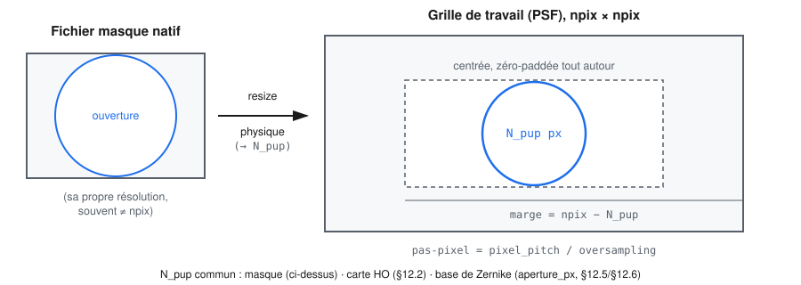
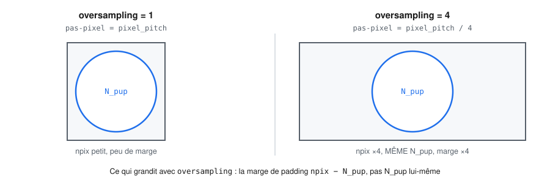
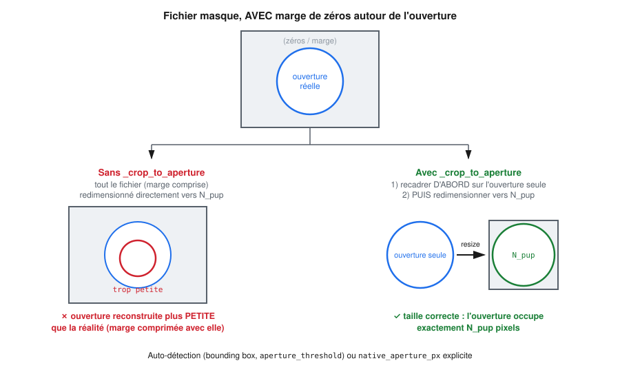
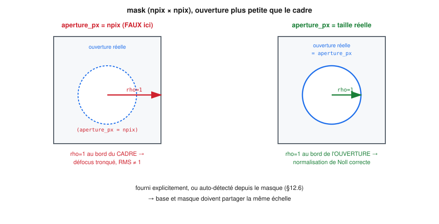

# eoqual-phaseretrieval — Référence technique

> Document de référence théorique **et** technique de ce module. Il couvre
> la famille complète des méthodes de récupération de phase implémentées ici — y
> compris la diversité de phase, qui en est une variante à deux images plutôt
> qu'une méthode indépendante — d'où le nom du module (« phase retrieval »
> chapeaute « phase diversity », pas l'inverse). Les trois méthodes partagent la même
> base physique (§1‑2) et la même interface de code (§6).

---

## 1. Pourquoi le phase‑retrieval ?

- La PSF est l'intensité du champ focal :

$$
\text{PSF}(x,y)=\bigl| \mathcal{F}\{P(\xi,\eta)\,e^{i\phi(\xi,\eta)}\}\bigr|^{2}
$$

où $P$ est la fonction pupille (amplitude, ex. le masque binaire) et $\phi$
le terme de phase que l'on cherche (la WFE — *Wave-Front Error*).
- En connaissant $P$ (forme de l'ouverture, éventuelles obstructions, etc.)
et la **longueur d'onde** utilisée, la PSF contient indirectement
l'information de $\phi$.
- Récupérer $\phi$ à partir d'une mesure d'intensité uniquement est
exactement le problème de *phase retrieval* [1, 2].
- Une fois $\phi$ connue, elle est usuellement décomposée sur la base des
polynômes de Zernike, en **ordre de Noll** [3], ce qui donne des
coefficients directement interprétables (défocus, astigmatisme, coma, …) et
un critère de qualité optique compact : le **Strehl ratio** peut être
approché par $S \approx \exp\!\bigl[-(2\pi\,\sigma_{\text{WFE}}/\lambda)^2\bigr]$
pour de petites aberrations ($\sigma_{\text{WFE}} \lesssim \lambda/14$) [4].

---

## 2. Limites d'une récupération à partir d'une **seule** PSF

| Ambiguïté | Description |
|-----------|-------------|
| **Piston** | Un terme constant $\phi_0$ ne change pas la PSF (on ne le récupère pas). |
| **Symétrie de signe** | $\phi$ et $-\phi$ produisent la même PSF (ambiguïté de signe / conjugaison). |
| **Tip‑tilt** | Un décalage linéaire du front d'onde se traduit par un déplacement du PSF ; si le recadrage n'est pas connu, tip‑tilt reste indéterminé. |
| **Conjugaison complexe** | La transformation de Fourier étant symétrique, il y a parfois deux solutions conjuguées de la pupille elle-même. |

**Conclusion :** avec une PSF seule, on ne peut récupérer que la **forme**
de la WFE modulo ces degrés de liberté [1, 5]. C'est précisément ce que la
*diversité de phase* (§3.4) est conçue pour lever, en ajoutant une seconde
mesure dans laquelle l'ambiguïté ne se manifeste pas de la même façon.

### 2.1 Amplitude et centrage : que récupèrent réellement ces méthodes ?

Question fréquente, à préciser avant tout usage sur des données réelles :
les trois méthodes ne récupèrent **que la phase** $\phi$, jamais
l'amplitude de la pupille $P$, qui est toujours prise comme une donnée
d'entrée fixe (le masque binaire fourni à `psf_to_wfe`) — pas comme un
paramètre ajusté. Une pupille réellement apodisée (transmission non
uniforme, vignettage) et modélisée ici par un masque purement binaire
introduit donc un biais de modèle qui n'est jamais détecté ni corrigé par
l'algorithme lui-même.

Le centrage (décalage $dx, dy$ du pic de la PSF, physiquement équivalent
au tip-tilt $Z_2, Z_3$ — voir la ligne « Tip-tilt » ci-dessus) est traité
différemment selon la méthode, et **aucune des trois ne l'estime par
défaut** :

| Méthode | Tip-tilt / décalage | Détail |
|---|---|---|
| `"optimization"` | Estimable en option | `OpticalConfig(fit_piston_tilt=True)` ajoute $Z_2, Z_3$ aux paramètres libres — physiquement équivalent à un décalage sous-pixel dans l'approximation paraxiale. `False` par défaut : $Z_1$–$Z_3$ figés à 0. |
| `"gerchberg_saxton"` | Non restituable | La phase brute récupérée pixel à pixel peut absorber un décalage réel, mais `zernike_fit.fit_zernike` **remet systématiquement $Z_1$–$Z_3$ à zéro** après projection (`# Remove piston and tilts`) : même si GS l'a implicitement « vu », l'information est perdue à l'étape de décomposition en Zernike. |
| `"phase_diversity"` | Non implémenté | $Z_1$–$Z_3$ sont figés à 0 en dur (`coeffs[3:] = active_coeffs`), sans option pour les libérer — un vrai décalage entre les deux PSF biaiserait donc l'ensemble du fit conjoint. |

**Implication pratique :** l'implémentation actuelle suppose que la (les)
PSF fournie(s) en entrée sont déjà recentrées sur la grille (pic au
centre géométrique du tableau) — c'est typiquement le rôle d'une étape de
recalage en amont (voir §5.0 : Shift-and-Add, ePSF, PSFr) plutôt que de la
récupération de phase elle-même. Sur une PSF mal centrée, `"optimization"` avec
`fit_piston_tilt=True` est la seule option qui peut absorber un léger
décalage résiduel ; les deux autres méthodes en hériteraient un biais sur
tous les coefficients (le modèle, toujours centré par construction —
`optics.psf_from_phase` — ne peut pas reproduire un pic décalé autrement
qu'en dégradant l'ajustement des modes réels).

### 2.2 Modifications envisageables pour les récupérer

Deux problèmes de nature très différente — l'un tractable avec les outils
déjà en place, l'autre une refonte plus profonde.

**Centrage (tip-tilt $Z_2, Z_3$) — tractable.**

- `"phase_diversity"` est le vrai manque : contrairement à `"optimization"`,
  aucune option n'existe pour libérer $Z_2, Z_3$. Ajout naturel : un
  `fit_tip_tilt: bool = False` sur `PhaseDiversityConfig`, qui étendrait
  `active_coeffs` à `coeffs[1:]` (Z2 et au-delà) au lieu de `coeffs[3:]`
  dans `residuals`/`fit_phase_diversity` — même mécanique que
  `OpticalConfig.fit_piston_tilt`, sans toucher au reste du modèle
  (`diversity_phase` reste inchangée, elle ne dépend que de `basis[3]`).
- Nuance sur `"optimization"` : `fit_piston_tilt=True` libère *aussi* le
  piston ($Z_1$), un paramètre strictement inerte (une constante de phase
  n'affecte jamais $|\cdot|^2$ dans `psf_from_phase`) — `least_squares` le
  laisse à 0 pendant tout l'ajustement, sans erreur, mais c'est un
  paramètre gaspillé. Un nom plus précis, `fit_tip_tilt`, qui ne libère
  que $Z_2, Z_3$, serait plus correct (à garder rétro-compatible via un
  alias, ou à documenter tel quel — piston inerte, sans conséquence).
- `"gerchberg_saxton"` : ajouter un `zero_tip_tilt: bool = True` sur
  `ZernikeConfig`/`fit_zernike` permettrait de ne plus jeter le tip-tilt
  que GS a implicitement absorbé dans sa phase pixel à pixel (contrairement
  au piston $Z_1$, dont la valeur GS est arbitraire — un vrai artefact de
  l'initialisation aléatoire, pas une mesure — et qui doit rester filtré).
- **Alternative recommandée en amont plutôt qu'en aval** : un recalage
  sous-pixel par corrélation de phase (déjà cité §5.0, Shift-and-Add)
  avant même d'appeler `psf_to_wfe`, est la solution la plus robuste — un
  tip-tilt Zernike n'est une bonne approximation d'un décalage réel que
  dans le régime paraxial (petits décalages), alors qu'une corrélation de
  phase reste valide à n'importe quelle amplitude de décalage. Les options
  ci-dessus sont utiles en secours (décalage résiduel sous-pixel après un
  recalage imparfait), pas comme substitut à un recalage correct en amont.

**Amplitude de la pupille — refonte plus profonde, et d'identifiabilité
incertaine avec la donnée actuelle.**

- Un premier obstacle est réglable sans toucher aux algorithmes : `mask`
  n'a *besoin* d'être binaire nulle part dans `optics.psf_from_phase`
  (`pupil = mask * exp(i·phase)` accepte déjà n'importe quelle amplitude
  réelle dans `[0, 1]`) — c'est
  `io_utils.load_and_prepare_mask` qui **force** la binarisation
  (`(mask_raw > 0.5).astype(uint8)`). Une pupille apodisée *mesurée
  indépendamment* (calibration labo, modèle as-built) pourrait donc déjà
  être utilisée telle quelle, comme amplitude fixe, en assouplissant
  uniquement ce chargeur — sans aucune modification des trois méthodes de
  récupération de phase, puisqu'aucune ne suppose l'amplitude binaire nulle
  part ailleurs dans le calcul.
- **Ajuster** l'amplitude conjointement à la phase (plutôt que la mesurer
  à part) est une tout autre ampleur de changement :
  - Il faudrait un modèle paramétrique de transmission (ex. une expansion
    radiale à quelques coefficients, $P=\text{mask}\cdot(1+\sum_k a_k R_k(\rho))$)
    plutôt qu'une amplitude libre pixel par pixel (bien trop de paramètres
    pour rester bien posé, à l'inverse de la philosophie « quelques
    dizaines de coefficients » de ce projet, §1).
  - Pour `"optimization"`/`"phase_diversity"` : ajouter les $a_k$ au
    vecteur de paramètres libres de `least_squares`, et modifier
    `psf_from_phase` (ou une variante) pour prendre un `pupil` complet
    plutôt qu'un masque fixe — mécaniquement direct, mais avec un vrai
    risque d'identifiabilité (voir §11.2 : plusieurs effets peuvent
    produire une signature MTF similaire) qu'il faudrait vérifier
    empiriquement avant de faire confiance au résultat, surtout avec une
    seule PSF (`"optimization"`) — `"phase_diversity"`, avec ses deux
    images à aberration connue et différente, est structurellement mieux
    posée pour espérer séparer amplitude et phase.
  - `"gerchberg_saxton"` n'est pas un bon candidat : l'algorithme repose
    sur l'imposition d'une amplitude **exacte et connue** dans le plan
    pupille à chaque itération — rendre cette amplitude elle-même
    inconnue change la nature du problème (retrouvé conjoint
    amplitude+phase), qui sort du cadre de l'algorithme GS classique
    implémenté ici.
  - Non implémenté à ce stade : à traiter comme une piste de recherche
    plutôt qu'une simple option à ajouter, contrairement au centrage
    ci-dessus.

### Illustration empirique

La validation menée dans [`examples/psf2zernike_demo.ipynb`](examples/psf2zernike_demo.ipynb) sur les
données du simulateur (`examples/data/*_simu.tiff`, vérité terrain
$Z_4=55{,}0$ nm, $Z_5=27{,}5$ nm) rend ces ambiguïtés très concrètes :

| Méthode | Corrélation avec la vérité | Interprétation |
|---|---|---|
| Optimisation directe (1 PSF) | **−1,00** | Ambiguïté de signe exacte — l'amplitude est juste, le signe est inversé. |
| Gerchberg‑Saxton (1 PSF) | −1,00 à +0,83 selon l'initialisation | Même ambiguïté, plus une sensibilité à l'initialisation aléatoire. |
| Diversité de phase (2 PSF) | **+1,00** | Ambiguïté levée par la seconde image. |

---

## 3. Panorama des méthodes de récupération de phase

| Méthode | Principe | Points forts / faibles | Référence(s) |
|---|---|---|---|
| **Gerchberg‑Saxton (GS)** | Alternance entre le plan pupille (imposer l'amplitude $P$, laisser la phase libre) et le plan image (imposer l'amplitude $\sqrt{\text{PSF}}$). | Simple à implémenter ; convergence non garantie, sensible aux minima locaux et à l'initialisation. | Gerchberg & Saxton (1972) [1] |
| **Error‑Reduction / Hybrid Input‑Output (HIO)** | Variantes de GS ; HIO introduit un terme de rétroaction $g_{k+1}=g_k-\beta g_k'$ hors du support pour éviter les stagnations. | Meilleure robustesse que GS pur ; paramètre de relaxation $\beta$ à régler (typ. 0,7–0,9). | Fienup (1978, 1982) [2, 5] |
| **Ajustement direct par optimisation non linéaire** (*model‑based fitting*) | Les coefficients de Zernike sont les paramètres libres d'un modèle direct $\text{PSF}_{\text{modèle}}(\mathbf{c})$ ; on minimise $\lVert\sqrt{\text{PSF}_{\text{modèle}}}-\sqrt{\text{PSF}_{\text{mes}}}\rVert^2$ par moindres carrés (ex. Trust‑Region‑Reflective). | Déterministe, rapide à converger, paramétrisation de dimension réduite (quelques dizaines de coefficients au lieu d'un pixel par pixel) ; hérite des mêmes ambiguïtés qu'une seule PSF (piston/tilt/signe). | Branch, Coleman & Li (1999) pour TRF [6] ; formulation proche de Fienup (1993) [7] |
| **Diversité de phase (*phase diversity*)** | On mesure **deux** (ou plus) PSF : une focalisée et une avec une aberration connue et volontairement introduite (typ. défocus). L'algorithme ajuste conjointement les deux images. | Résout l'ambiguïté de signe et de piston/tilt, améliore la stabilité ; nécessite un second cliché et de connaître précisément la diversité introduite. | Gonsalves (1982) [8] ; Paxman, Schulz & Fienup (1992) [9] |
| **Maximum de vraisemblance / bayésien, pondération de bruit et a priori individuels** | Formulation statistique qui pondère le résidu par le modèle de bruit (Poisson pour un détecteur à comptage de photons) et peut intégrer des a priori — globaux (parcimonie) ou **individuels, un par mode de Zernike** (valeur attendue ± incertitude, ex. issue d'une mesure de laboratoire ou d'un budget d'erreur), sous forme de pénalité L2 pondérée ou de contrainte de boîte. | Optimal statistiquement pour des PSF bruitées ; un a priori individuel bien choisi peut se substituer à une partie du rôle désambiguïsant d'une seconde image (§3.7), au prix d'un biais si l'a priori est faux. Plus coûteux, nécessite de connaître le modèle de bruit (et, pour la variante à a priori individuels, une incertitude par mode). | Löfdahl & Scharmer (1994) [10] |
| **Pertes robustes (M‑estimateurs)** | Remplace le résidu quadratique par une fonction moins sensible aux valeurs aberrantes (`soft_l1`, `huber`) dans l'optimiseur. | Complément aux deux méthodes basées optimisation, utile en présence de pixels chauds / saturation / mauvais pixels. | Huber (1964) [11] |
| **Approches linéarisées (OTF)** | On calcule l'OTF $= \mathcal{F}\{\text{PSF}\}$ ; le module de la pupille complexe est lié à $\sqrt{\text{OTF}}$, la phase se récupère par des méthodes linéaires (filtrage de Wiener, déconvolution). | Rapide, mais valable seulement pour de petites aberrations (approximation linéaire). | Goodman (2005), ch. 6 [4] |

### 3.6 Historiques ou toujours pertinentes ?

Aucune de ces méthodes n'est vraiment obsolète : chacune reste le meilleur
choix dans un régime particulier.

- **GS / HIO / Error‑Reduction** — nées les premières (1972–1982), elles
  restent **le standard actuel** dès que la phase n'est *pas* bien décrite
  par une poignée de modes Zernike (pupille segmentée, imagerie
  cohérente à rayons X/EUV — *coherent diffractive imaging*, lithographie).
  Là où notre paramétrisation modale s'applique (une pupille simple,
  quelques dizaines de coefficients suffisent), l'ajustement direct
  (§3, ligne 3) les rend souvent inutiles : il converge en quelques
  dizaines d'évaluations, de façon déterministe, contre des centaines
  d'itérations FFT/IFFT pour un résultat plus incertain (§3.7, §6.4).
- **Ajustement direct par optimisation non linéaire** — pas « historique »
  au sens où GS l'est ; c'est l'approche par défaut dès que le nombre de
  degrés de liberté est réduit (base de Zernike, base de modes de
  segments…), largement utilisée en métrologie optique actuelle. Sensible
  au choix de l'initialisation sur des cas difficiles (§3.7).
- **Diversité de phase** — **toujours activement utilisée**, en particulier
  en astronomie : c'est la technique employée pour la mise au point
  optique et le suivi de front d'onde du télescope spatial JWST en orbite,
  ainsi que dans plusieurs instruments solaires au sol. Rien d'historique
  ici.
- **Maximum de vraisemblance / pondération de bruit (Poisson) et a priori
  individuels** — c'est au contraire le raffinement **le plus moderne** des
  méthodes précédentes, de plus en plus pertinent avec les détecteurs à
  comptage de photons (imagerie faible flux, exoplanètes en imagerie
  directe). Notre option `poisson_weighting=True` de la diversité de phase
  (§6.3) *est* cette approche. **Précision (v. la remarque plus bas) :**
  cette ligne n'est pas une évolution de l'ajustement direct par
  optimisation (ligne du dessus) — c'est une évolution de la **diversité
  de phase elle‑même** et de son traitement statistique du bruit, comme le
  montrent ses propres références historiques (Paxman, Schulz & Fienup
  1992 [9] ; Löfdahl & Scharmer 1994 [10] ; Idier, Mugnier & Blanc 2005
  [16] ; Blanc, Mugnier & Idier 2003 [17], tous cités en diversité de
  phase, §8.3) : le point de départ est toujours la fonction de coût
  moindres carrés conjointe focus/défocus (§3, §4), à laquelle on
  substitue une pondération statistiquement correcte du bruit, puis un a
  priori. L'extension à un **a priori individuel par mode** (valeur
  attendue ± incertitude, plutôt qu'une simple parcimonie globale) en est
  la généralisation naturelle : elle prolonge à la fois ce traitement
  statistique du bruit (§8.3) et le mécanisme de désambiguïsation par a
  priori déjà présent dans le projet sous une forme simplifiée
  (`sign_prior`, un signe sur un seul mode, §3.7) — vers un a priori
  continu sur plusieurs modes à la fois. Poussée à l'extrême (a priori
  individuel fort sur chaque mode, cf. l'usage `individual_constraint` de
  la référence externe discutée en §6.5), cette généralisation peut même
  se substituer à la seconde image de diversité pour la désambiguïsation —
  ce qui en fait, dans ce cas limite, une manière de retrouver une partie
  du bénéfice de la diversité de phase **à partir d'une seule PSF**, en
  échangeant la mesure supplémentaire contre une connaissance a priori
  externe (risque de biais si cet a priori est faux, à la différence d'une
  vraie seconde mesure).
- **Pertes robustes (`soft_l1`, `huber`)** — un bon réflexe d'ingénierie
  plutôt qu'une "méthode" : à activer par défaut dès que des données
  réelles (pixels chauds, saturation) sont utilisées à la place de
  simulations propres.
- **Approches linéarisées (OTF)** — les plus datées en pratique : valables
  seulement pour de petites aberrations, elles restent utiles comme
  estimation initiale rapide (ex. boucle d'optique adaptative en régime
  déjà corrigé, où le résidu est petit par construction) mais sont
  supplantées par les méthodes non linéaires dès que l'aberration est
  significative.

### 3.7 Lever l'ambiguïté de signe par un a priori

**Peut-on récupérer le bon signe avec un a priori sur $Z_4$ (et éventuellement
d'autres modes) ?** Oui — et il suffit d'**un seul** a priori, sur **un
seul** mode, pour résoudre le signe de tous les modes concernés à la fois.
Ce résultat se démontre exactement, pas seulement empiriquement.

**Démonstration.** Pour une pupille $P$ réelle et centrosymétrique
($P(-\xi,-\eta)=P(\xi,\eta)$ — vrai pour toute ouverture circulaire ou
annulaire sans détail brisant la symétrie), l'identité de Fourier
$\lvert\mathcal{F}\{g^*(-\cdot)\}\rvert = \lvert\mathcal{F}\{g\}\rvert$
appliquée à $g=P\,e^{i\phi}$ montre que $(P,\phi)$ et
$(P,\,-\phi(-\xi,-\eta))$ produisent **exactement** la même PSF — c'est
l'ambiguïté « image jumelle », cataloguée par Millane (1990) [12] parmi les
ambiguïtés triviales de la reconstruction de phase. En décomposant $\phi$ sur la
base de Zernike (ordre de Noll $j$, fréquence azimutale $m_j$), l'inversion
de coordonnées donne $Z_j(\rho,\theta+\pi)=(-1)^{m_j}Z_j(\rho,\theta)$, d'où
les coefficients de la « jumelle » :

$$
c_j' = (-1)^{m_j+1}\,c_j
\qquad\Longrightarrow\qquad
\begin{cases}
c_j' = -c_j & \text{si } m_j \text{ pair (défocus } Z_4\text{, astigmatisme } Z_5,Z_6\text{, sphérique } Z_{11}, \dots) \\
c_j' = +c_j & \text{si } m_j \text{ impair (tip/tilt, coma } Z_7,Z_8\text{, trèfle } Z_9,Z_{10}, \dots)
\end{cases}
$$

**Conséquence pratique :** les modes de fréquence azimutale **impaire**
(coma, trèfle, coma secondaire, …) sont récupérés avec le **bon signe dès
la première PSF**, sans aucune ambiguïté. Seuls les modes de fréquence
**paire** (défocus, astigmatisme, sphérique, astigmatisme secondaire,
quadrafoil, …) peuvent être inversés — mais **ensemble**, comme un seul
bloc. Un unique a priori de signe sur *n'importe lequel* d'entre eux
(typiquement $Z_4$, dont le signe est souvent connu — sens d'un défocus
volontairement introduit) suffit donc à lever l'ambiguïté pour tous les
modes pairs simultanément ; rien à faire pour les modes impairs.

C'est implémenté dans [`zernike_fit.resolve_sign_ambiguity`](src/eoqual/phaseretrieval/zernike_fit.py)
et exposé via `psf_to_wfe(..., sign_prior=(4, +1.0))` (§6.3).

**Validation empirique** (phases synthétiques multi-modes, $j=4\dots13$ et
$j=4\dots15$, coefficients aléatoires, masque `examples/data/mask_simu.tiff`,
`examples/psf2zernike_demo.ipynb`) :

| Méthode | Sans correction | Avec correction (a priori sur $Z_4$) |
|---|---|---|
| Optimisation directe, solveur bien convergé (`cost≈0`) | corrélation aléatoire selon la branche atteinte (souvent $-1$) | **corrélation ≈ +1, RMS < 2 nm** (8/10 tirages directement ; 10/10 avec quelques redémarrages aléatoires en cas de minimum local) |
| Gerchberg‑Saxton | très variable | **améliore nettement certains tirages** (jusqu'à corrélation ≈ +0,999) **mais dégrade parfois les autres** |

Le correctif lève exactement l'ambiguïté théorique quand le solveur a
convergé vers l'une des deux branches exactes (coût quasi nul — à vérifier
via `diagnostics["cost"]`) ; il ne corrige pas une non‑convergence générique
(minimum local sans lien avec l'ambiguïté — un simple redémarrage
multi‑départ suffit à y remédier pour `"optimization"`, cf. §6.3). Pour
Gerchberg‑Saxton, la correction reste **peu fiable** : l'algorithme ne
converge presque jamais exactement vers l'une des deux branches théoriques,
si bien que le signe du mode de référence ($Z_4$) utilisé pour décider du
correctif est lui‑même parfois erroné — le correctif peut alors dégrader le
résultat au lieu de l'améliorer. `"phase_diversity"` reste la seule méthode
qui lève l'ambiguïté de façon fiable, sans hypothèse a priori (§3.4).

---

## 4. Méthodes retenues dans ce projet

Sur les sept familles ci-dessus, trois sont implémentées — les deux
premières lignes du panorama (Error‑Reduction/HIO pur) n'ont pas été
retenues séparément : notre implémentation GS correspond à l'algorithme
originel de Gerchberg & Saxton (le paramètre `beta` de
[`RetrievalConfig`](src/eoqual/phaseretrieval/backends/gerchberg_saxton.py) est réservé à une future extension
HIO). La pondération de bruit Poisson et les pertes robustes ne sont pas
des méthodes à part entière mais des options de la diversité de phase.

| `method=` (code) | Technique | Référence principale | Module |
|---|---|---|---|
| `"gerchberg_saxton"` | Gerchberg‑Saxton | [1] | [`backends/gerchberg_saxton.py`](src/eoqual/phaseretrieval/backends/gerchberg_saxton.py) |
| `"optimization"` | Ajustement direct par moindres carrés non linéaires | [6, 7] | [`backends/optimization.py`](src/eoqual/phaseretrieval/backends/optimization.py) |
| `"phase_diversity"` | Diversité de phase modale, pondération Poisson optionnelle, perte robuste optionnelle | [8, 9, 10, 11] | [`backends/phase_diversity.py`](src/eoqual/phaseretrieval/backends/phase_diversity.py) |

La décomposition finale en coefficients de Zernike (ordre de Noll) est
commune aux trois méthodes : linéaire par moindres carrés pour GS (la phase
est d'abord récupérée pixel à pixel, puis projetée — voir
[`zernike_fit.py`](src/eoqual/phaseretrieval/zernike_fit.py)), directe pour les deux autres (les
coefficients *sont* les paramètres de l'optimisation).

---

## 5. Workflow typique (exemple avec diversité de phase)

### 5.0 D'où vient la PSF d'entrée ?

`psf_to_wfe` (§6) part d'une PSF déjà formée — mais sur un instrument réel,
cette PSF unique est rarement une simple exposition brute : elle est le
plus souvent **reconstruite à partir d'un burst** de plusieurs images
légèrement décalées (dithering, agilité du satellite, turbulence
moyennée), pour dépasser le sous-échantillonnage du détecteur. Trois
familles de méthodes, par complexité croissante :

- **Shift-and-Add / Drizzle** — recalage sous-pixel (souvent par
  corrélation de phase) puis projection/empilement sur une grille
  sur-échantillonnée [21].
- **ePSF (Effective PSF)** — méthode empirique itérative d'Anderson & King
  [22], devenue le standard pour HST/JWST ; implémentée par
  `photutils.psf.EPSFBuilder`.
- **PSFr** — variante itérative par résidus, alignement/recentrage répété
  à chaque itération.

C'est exactement ce que fait le projet séparé `starpsfsr` (mêmes trois
méthodes, sur données Bayer multi-bandes — voir aussi §8.1) : sa sortie
(une PSF par bande) est le point d'entrée naturel de ce pipeline-ci. Aucune
des trois méthodes ne fait partie de ce dépôt.

1. **Acquisition des images**
   - PSF focalisée (à focus nominal).
   - PSF avec une diversité connue (ex. défocus de $\Delta z$ introduit
     volontairement).

2. **Modélisation du système**
   - Fonction pupille $P(\xi,\eta)$ (circulaire, annulaire, obstruction
     centrale, araignées) → masque binaire dans ce projet.
   - Longueur d'onde $\lambda$.
   - Paramètre de diversité (défocus $\Delta z$ → phase quadratique connue,
     mode de Noll $Z_4$).

3. **Algorithme de récupération**
   ```text
   initialiser φ (ou les coefficients de Zernike c)
   répéter jusqu'à convergence :
       - passer au plan image (FFT) → comparer à sqrt(PSF_foc) et sqrt(PSF_div)
       - mise à jour de φ (ou de c) selon l'algorithme choisi (GS, TRF, …)
   ```
   La convergence est surveillée via une métrique d'erreur, par exemple le
   coût des moindres carrés $\varepsilon = \lVert\sqrt{I_{\text{mod}}}-\sqrt{I_{\text{mes}}}\rVert_2$
   pour les méthodes par optimisation, ou la corrélation phase mesurée vs.
   phase déroulée pour GS.

4. **Post‑traitement**
   - Décomposition de la phase $\phi(\xi,\eta)$ en coefficients Zernike
     (ordre de Noll).
   - Suppression du piston, tip‑tilt ($Z_1$–$Z_3$, non observables sans
     référence externe).
   - Visualisation : carte de WFE (nm), PSF prédite vs. mesurée.

5. **Validation**
   - Re‑simulation de la PSF à partir de la WFE estimée et comparaison avec
     les mesures (RMSE dans `diagnostics["psf_rmse"]` / `"psf_*_rmse"`).
   - Comparaison à une vérité terrain simulée (`examples/data/phase_simu.tiff`) ou,
     idéalement, à une mesure indépendante (Shack‑Hartmann, interférogramme).

---

## 6. Implémentation technique

### 6.1 Architecture des modules

```
src/eoqual/phaseretrieval/
    io_utils.py                    # chargement image/masque, enveloppes Plotly spécifiques
    optics.py                      # base de Zernike, modèle direct phase -> PSF
    zernike_fit.py                 # décomposition d'une carte de phase (Noll)
    pipeline.py                    # psf_to_wfe(method=...) + CLI unifiée
    diagnostics.py                 # Strehl, WFE (Maréchal), MTF, ellipticité (§9)
    zernike_basis_orthogonal.py    # base Zernike orthogonalisée (pupille obstruée, §10)
    pupil.py                       # pupilles disque/annulaire/araignées (test, §10)
    config.py                      # registre METHODS_CONFIGS
    runner.py                      # list_methods()
    backends/
        gerchberg_saxton.py        # Gerchberg-Saxton                  (1 PSF)
        optimization.py            # optimisation directe              (1 PSF)
        phase_diversity.py         # diversité de phase modale         (2 PSF)
    simulation/                    # génération de cas de test (vérité connue) — voir §6.7
        psf_simulator.py
        phase_diversity_simulator.py
        noise.py
        star_profiles.py           # simulation étoile empirique (Gauss/Moffat/Airy, Bayer)
examples/
    psf2zernike_demo.ipynb         # démonstration + validation
    simu_psf_mask.ipynb            # simulateur PSF (monochrome + Bayer RGuGlB, Zernike+FFT)
```

`optics.py` et `zernike_fit.py` sont les briques partagées : les deux
méthodes par optimisation (`backends/optimization.py`,
`backends/phase_diversity.py`) s'appuient sur `optics.phase_from_coefficients`
et `optics.psf_from_phase` pour évaluer leur modèle direct à chaque
itération du solveur ; `backends/gerchberg_saxton.py` n'en a pas besoin
(il travaille directement sur la phase pixel à pixel) mais passe par
`zernike_fit.py` *après coup* pour produire des coefficients comparables
aux deux autres
méthodes.

**Fonctions graphiques génériques (heatmap 2D, comparaison de
courbes/coupes avec repères verticaux) externalisées dans
[`eoqual-viz`](https://github.com/EOQual/eoqual-viz)** — elles n'avaient
rien de spécifique à la récupération de phase (ex-`io_utils.plot_array_plotly`,
ex-`io_utils.plot_mtf_cuts`). `io_utils.py` ne garde que les enveloppes
spécifiques à ce projet (`plot_mtf_cuts`, assemblage des coupes FTM +
fréquence de coupure avant de passer les tableaux à
`eoqual.viz.plot_curve_grid`) et `diagnostics.py` les fonctions
purement numériques (`mtf_frequency_axis`, `mtf_cutoff_frequency`,
`mtf_cuts`, `mtf_value_at`, `mtf_integral`, §9.5) — ces dernières sont
restées ici plutôt que dans `eoqual-core` : sa propre règle de
gouvernance n'y admet une brique que si **au moins deux modules**
l'utilisent (voir `eoqual-core/README.md` §Règles), ce qui n'est pas
encore le cas. `encircled_energy` et `fwhm` (§9.5), à l'inverse,
délèguent bien à `eoqual-core` (`psf.encircled_energy`, `edge.fwhm`) :
ces fonctions-là y existaient déjà, utilisées par d'autres modules —
aucune nouvelle brique à y faire accepter.

### 6.2 Point d'entrée unifié

```python
coeffs_nm, phase_fit_nm, diagnostics = psf_to_wfe(
    psf_path, mask_path, wavelength, focal_length, pupil_diameter, pixel_pitch,
    method="gerchberg_saxton" | "optimization" | "phase_diversity",
    oversampling=1,  # §12 : >1 pour une PSF suréchantillonnée (super-résolution)
    zernike_order=36,
    # ... paramètres spécifiques à chaque méthode (voir pipeline.py) ...
)
```

`psf_to_wfe` ([`pipeline.py`](src/eoqual/phaseretrieval/pipeline.py)) charge la PSF et le masque une
seule fois (`io_utils.load_image`, `io_utils.load_and_prepare_mask`), puis
dispatch vers le module correspondant à `method`. `diversity_path` et
`defocus` ne sont utilisés (et requis) que par `"phase_diversity"` ; ils
sont ignorés — avec un avertissement `loguru` — pour les deux autres
méthodes. C'est le choix architectural documenté en tête de ce fichier :
un point d'entrée commun, mais aucune logique de méthode mélangée entre les
modules.

### 6.3 Détail par méthode

| | GS | Optimisation | Diversité de phase |
|---|---|---|---|
| Config | `RetrievalConfig` | `OpticalConfig` | `PhaseDiversityConfig` |
| Variables ajustées | phase $\phi$ (par pixel) | coefficients $c_4 \dots c_N$ | coefficients $c_4 \dots c_N$ |
| Fonction de coût | contraintes d'amplitude alternées (pas de coût explicite) | `backends.optimization.residuals` | `backends.phase_diversity.residuals` (deux canaux concaténés) |
| Solveur | boucle FFT/IFFT (`max_iter` itérations) | `scipy.optimize.least_squares(method="trf")` | idem, + `loss=` robuste et pondération Poisson optionnelle |
| Étape Zernike | `zernike_fit.fit_zernike` (a posteriori, moindres carrés linéaires) | intégrée à l'optimisation | intégrée à l'optimisation |
| Diagnostics | rang, conditionnement, RMS résiduel (nm) | coût, `nfev`, RMSE PSF | coût, `nfev`, RMSE PSF (focus + défocus) |

`sign_prior=(reference_index, expected_sign)` — ex. `(4, +1.0)` — résout
l'ambiguïté de signe des modes pairs pour `"gerchberg_saxton"` et
`"optimization"` (voir §3.7 pour la théorie et ses limites) ; ignoré (avec
avertissement) pour `"phase_diversity"`, déjà non ambiguë.

`roi_radius` (diversité de phase uniquement) restreint le résidu de
`least_squares` à une fenêtre carrée centrée de demi-largeur `roi_radius`
px — avec la valeur par défaut (32) sur nos images 256×256
(`examples/data/psf_simu.tiff`), c'est une fenêtre de 64×64 px, soit environ 6 % des
pixels. Ce n'est pas cosmétique : la quasi-totalité de l'énergie utile
d'une PSF (tache d'Airy + anneaux) est concentrée près du centre, alors que
les pixels de bord ne contiennent presque que du bruit de fond (voire des
artefacts — repliement FFT, autre source dans le champ, pixel chaud) ; les
inclure dans le résidu dilue le signal utile sans rien apporter, et
ralentit le solveur pour rien. Le compromis à régler : trop petit, on coupe
une partie du signal qui contraint les modes de Zernike élevés (qui
étalent la tache plus loin du centre) ; trop grand, on réintroduit du bruit
de fond inutile. `roi_radius=32` convient à nos images 256×256 avec
`zernike_order≈15`, mais est à ajuster si la taille réelle de la tache
change (autre `zernike_order`, niveau d'aberration, échantillonnage
pupille/détecteur différent).

`core_weight_radius` / `l2_reg` (méthode `"optimization"` uniquement,
`OpticalConfig`, désactivés par défaut = comportement inchangé) apportent à
l'optimisation directe le même principe que `roi_radius` sans en payer le
coût — pas de fenêtre dure qui coupe le signal, mais une pondération douce
(taper gaussien) qui priorise le cœur à haut SNR sur les ailes bruitées
(`core_weight_radius`), et une régularisation de Tikhonov qui stabilise le
fit quand il est sous-contraint (`l2_reg`, ordre élevé + PSF peu
lumineuse/bruitée).

### 6.4 Validation

La validation numérique utilise le module de simulation (§6.7,
`eoqual.phaseretrieval.simulation`), qui génère une vérité de Zernike
connue à la demande — `tests/test_simulation_roundtrip.py` est la suite
de référence (simulation → récupération de phase → comparaison à la vérité
terrain), rejouée à chaque exécution des tests plutôt que figée dans des
fixtures. Les résultats de fond sont résumés en §2 ; ils confirment sur
des données contrôlées les ambiguïtés théoriques du §2 et §3, et donnent
une reconstruction quasi exacte (RMS ≈ 0 nm) pour la diversité de phase
en l'absence de bruit — voir aussi `examples/psf2zernike_demo.ipynb` pour
une démonstration interactive équivalente, à base des données
`examples/data/*_simu.tiff`.

### 6.5 Étendre le code (ajouter une 4ᵉ méthode)

1. Créer `backends/<nom>.py` avec sa propre dataclass de configuration et
   sa fonction `fit_...(psf(s), mask, cfg) -> (coeffs_nm, diagnostics)`,
   en réutilisant `optics.py` si la méthode passe par un modèle direct
   PSF(coeffs).
2. Ajouter la valeur correspondante à `pipeline.METHODS` (et une entrée à
   `config.METHODS_CONFIGS`) et une branche de dispatch dans `psf_to_wfe`.
3. Ajouter les options CLI correspondantes dans `build_arg_parser`.
4. Ajouter un test dans `tests/test_simulation_roundtrip.py` (simulation
   → nouvelle méthode → comparaison à `coeffs_nm` de vérité) et, si utile,
   une section de démonstration dans `examples/psf2zernike_demo.ipynb`.

### 6.5bis A priori individuels par mode (`zernike_priors` / `zernike_bounds`)

À la suite d'une revue de scripts externes (non intégrés au projet)
implémentant des a priori individuels par mode via PyTorch/`torchmin`
(minimisation à contraintes de boîte ou pénalité L2 autour d'une valeur
attendue par mode), deux voies étaient envisageables : (a) une **option**
sur les méthodes existantes, ou (b) un **4ᵉ backend**. Choix retenu et
implémenté : **(a), une option** (module
[`zernike_priors.py`](src/eoqual/phaseretrieval/zernike_priors.py), branché
sur `OpticalConfig`/`PhaseDiversityConfig`/`psf_to_wfe`) — pour deux
raisons indépendantes :

- **Le modèle direct ne change pas.** Un a priori individuel par mode
  n'est qu'un terme de pénalité $\sum_k w_k\,(c_k-\bar c_k)^2$ ajouté au
  résidu (ou une borne par coefficient), au‑dessus du même
  $\text{PSF}_{\text{modèle}}(\mathbf c)$ déjà utilisé par `"optimization"`
  et `"phase_diversity"`. Ce n'est pas un changement de méthode au sens de
  §6.5 (qui suppose un modèle direct ou une stratégie de résolution
  différente) : c'est un terme de coût supplémentaire, paramétrable par
  une nouvelle entrée de configuration (ex. `zernike_priors:
  Dict[int, Tuple[float, float]]`, mode Noll → (valeur attendue nm,
  écart‑type nm)) sur `OpticalConfig`/`PhaseDiversityConfig`, dans la même
  veine que `sign_prior` (§3.7) déjà présent. Une pénalité L2 s'exprime
  nativement comme des lignes supplémentaires du vecteur de résidus de
  `scipy.optimize.least_squares` — aucune dépendance à un cadre
  différentiable n'est nécessaire pour cette seule extension.
- **Le gain de performance de l'implémentation PyTorch de référence n'est
  pas lié à l'a priori, mais au jacobien.** Comparaison chronométrée
  (`fit_zernike_from_psf` vs. un portage direct de `psf_from_phase` en
  PyTorch + `torch.optim.LBFGS`, même pupille, même bruit, CPU) :

  | Ordre de Zernike | scipy (`least_squares`, jacobien par différences finies) | PyTorch (rétropropagation) |
  |---|---|---|
  | 12 | 0,09 s | 0,05 s |
  | 36 | 3,6 s | 0,05 s |
  | 66 | 17–42 s | 0,11 s |

  L'écart croît avec l'ordre (×70 à 36, ×270 à 66) pour une raison
  structurelle : `least_squares` évalue le modèle direct par différences
  finies pour construire son jacobien (coût par itération proportionnel au
  nombre de coefficients libres), alors que la rétropropagation calcule un
  gradient exact en une seule passe, à coût quasi indépendant du nombre de
  paramètres. **Ce n'est donc pas une différence négligeable propre à ce
  projet** (ordre ≤36 en pratique courante) : dès l'ordre 36 l'écart est
  déjà d'un ordre de grandeur. Mais ce gain vient du calcul du gradient,
  pas de la formulation bayésienne de l'a priori — ajouter un a priori
  individuel ne le crée ni ne le supprime. Un futur passage à un jacobien
  analytique (le modèle `psf_from_phase` est dérivable en forme close) ou
  à l'autodiff (JAX/PyTorch) resterait donc une décision **séparée**, à
  ne prendre que si un besoin réel s'installe (ordres bien supérieurs à
  36, ajustements répétés en volume, ou GPU) — pas un prérequis pour
  exploiter l'idée d'a priori individuels.

**La logique, en détail (pourquoi ce n'est pas une nouvelle "méthode").**
Une estimation MAP (maximum a posteriori) maximise
$p(\mathbf c\mid\text{mesure})\propto p(\text{mesure}\mid\mathbf c)\,p(\mathbf c)$,
donc minimise $-\log p(\text{mesure}\mid\mathbf c)-\log p(\mathbf c)$. Avec un
bruit gaussien, $-\log p(\text{mesure}\mid\mathbf c)=\lVert\text{modèle}-\text{mesure}\rVert^2$
— le moindres‑carrés déjà utilisé partout dans ce projet. Avec un a priori
**gaussien** par mode $c_k\sim\mathcal N(\bar c_k,\sigma_k^2)$,
$-\log p(\mathbf c)=\sum_k(c_k-\bar c_k)^2/\sigma_k^2$ — une **pénalité L2**.
Avec un a priori **uniforme** sur $[\text{low}_k,\text{high}_k]$ (nul en
dehors), $-\log p(\mathbf c)$ vaut $0$ à l'intérieur et $+\infty$ en dehors
— une **contrainte de boîte**. Un MAP gaussien et un moindres‑carrés
pénalisé L2 ne sont donc pas deux méthodes différentes : c'est **la même
formule**, écrite dans deux vocabulaires (statistique / numérique) ; de
même pour un MAP à prior uniforme et une borne dure.

`OpticalConfig.l2_reg` (§6.3 plus haut) est déjà un **cas particulier** de
ce mécanisme : un a priori gaussien centré sur **zéro**, avec le **même**
poids pour tous les modes. `zernike_priors`/`zernike_bounds` généralisent
ce cas particulier à un a priori **individuel** (moyenne et poids propres
à chaque mode), sous forme de pénalité ou de borne dure. Concrètement,
`zernike_priors`/`zernike_bounds` ajoutent des lignes supplémentaires au
vecteur de résidus de `scipy.optimize.least_squares` (même mécanisme que
`l2_reg`) et, pour les bornes, un `bounds=` natif à `least_squares`
(inutilisé jusqu'ici) — voir
[`zernike_priors.build_prior_penalty`](src/eoqual/phaseretrieval/zernike_priors.py)/
[`build_prior_bounds`](src/eoqual/phaseretrieval/zernike_priors.py) pour le
détail des conversions nm ↔ rad et
[`feasible_start`](src/eoqual/phaseretrieval/zernike_priors.py) pour un
piège évité (démarrer *exactement* sur une borne finie, ex.
`(0.0, 400.0)`, dégénère la mise à l'échelle interne de `trf` et peut faire
déclarer au solveur une convergence immédiate et fictive — corrigé en
écartant légèrement le point de départ d'une borne sur laquelle il
tomberait).

**Exemple d'usage** — un a priori individuel de laboratoire (mesure
interférométrique préalable, incertaine) sur le sphérique ($Z_{11}$), et
une borne physique large sur le défocus ($Z_4$, jamais négatif dans ce
montage) :

```python
from eoqual.phaseretrieval import OpticalConfig, fit_zernike_from_psf

cfg = OpticalConfig(
    wavelength=550e-9,
    zernike_order=36,
    zernike_priors={11: (8.0, 3.0)},   # Z11 = 8 nm ± 3 nm (a priori labo)
    zernike_bounds={4: (0.0, 500.0)},  # Z4 physiquement dans [0, 500] nm
)
coeffs_nm, diagnostics = fit_zernike_from_psf(psf, mask, cfg)
```

Même API sur `PhaseDiversityConfig`/`psf_to_wfe(zernike_priors=...,
zernike_bounds=...)`. Un mode absent des deux dictionnaires reste libre,
sans pénalité — comportement historique inchangé par défaut (`None`).
Voir `examples/psf2zernike_demo.ipynb`, section « Fonctionnalités
avancées », pour une démonstration exécutable (y compris le cas où un a
priori fort désambiguïse/débiaise un ajustement autrement mal contraint).

**Mise en garde — d'où doit venir un a priori, dans ce contexte.** Rien
n'empêche techniquement d'utiliser `zernike_priors` pour encoder une
hypothèse générique du type « les modes de haut ordre radial ont une
amplitude décroissante » (courante en optique adaptative sol, où elle vient
de la statistique de turbulence de Kolmogorov — la variance du coefficient
de Noll $j$ décroît comme une loi de puissance de l'ordre radial, résultat
de Noll 1976). **Cette hypothèse n'est en général pas justifiée pour la
WFE propre d'un instrument d'observation de la Terre** (§8) : contrairement
à la turbulence atmosphérique, la WFE statique d'un instrument spatial
(fabrication, assemblage, thermo‑élastique en orbite) n'a aucune raison de
suivre un spectre de Kolmogorov — elle peut être dominée par quelques modes
bas ordre (défauts d'alignement), ou porter une contribution haut ordre
significative et localisée (print‑through d'un miroir allégé, réplique de
polissage) sans décroissance monotone. Un a priori raisonnable dans ce
contexte doit venir d'une source **spécifique à l'instrument** — modèle
optique as‑built, budget d'erreur, calibration sol/vol antérieure (§8.2) —
et non d'une décroissance générique empruntée à la littérature de
turbulence atmosphérique ; à défaut d'une telle source, préférer
`l2_reg` (a priori faible et neutre, sans favoriser arbitrairement une
forme de spectre) à un `zernike_priors` inventé.

**Déclencheurs concrets** (pour ne plus avoir à rouvrir la question à
chaque fois) — passer à un jacobien analytique ou à l'autodiff dès que
**l'un** de ces critères devient vrai en usage réel (pas en exploration) :

- `zernike_order` routinier > ~40 (le point où l'écart chronométré ci‑dessus
  dépasse ~×70, tableau ci‑dessus) ;
- volume : ajustements répétés en série (monitoring image par image,
  campagne de calibration multi‑poses) où le temps cumulé devient un facteur
  opérationnel, même à ordre modéré ;
- un GPU est déjà disponible dans l'environnement cible (le gain
  d'autodiff se cumule alors avec le parallélisme matériel).

**Ce qu'il faudrait concrètement**, par ordre de coût croissant :

1. **Jacobien analytique dans `scipy`, sans nouvelle dépendance** — à
   tenter en premier. `psf_from_phase` est une fonction analytique fermée
   des coefficients (FFT d'une exponentielle complexe) ; le jacobien de
   $\sqrt{\text{PSF}_{\text{modèle}}}$ par rapport à $\mathbf c$ se dérive
   en forme close et se passe à `least_squares(..., jac=...)` — supprime
   l'évaluation par différences finies sans quitter numpy/scipy. Récupère
   une bonne partie du gain observé sans ajouter de dépendance ; à évaluer
   avant l'option suivante.
2. **Backend autodiff optionnel** (PyTorch ou JAX) — seulement si (1) ne
   suffit pas. Éléments nécessaires : un port différentiable de
   `phase_from_coefficients`/`psf_from_phase` (FFT complexe, déjà supportée
   nativement par l'autodiff des deux bibliothèques) ; un nouveau backend
   `backends/<nom>.py` suivant le patron de §6.5 (même signature
   `fit_...(psf, mask, cfg) -> (coeffs_nm, diagnostics)`, pour rester
   interchangeable via `psf_to_wfe(method=...)`) ; la dépendance ajoutée en
   **extra optionnel** de `pyproject.toml` (ex. `poetry install -E torch`),
   pas en dépendance de base, pour ne pas alourdir l'installation par
   défaut (§6.5bis, comparatif de dépendances) ; un test de non‑régression
   comparant les coefficients récupérés à ceux de `"optimization"` sur un
   même cas simulé (`tests/test_simulation_roundtrip.py`), pour garantir
   l'équivalence numérique avant d'en faire une alternative de confiance ;
   et un test de performance chronométré (le tableau ci‑dessus, codifié en
   test plutôt qu'en observation ponctuelle) pour objectiver le
   déclencheur plus haut au lieu de le réargumenter qualitativement.

### 6.6 Interface en ligne de commande

```bash
python -m eoqual.phaseretrieval.pipeline \
    --method {gerchberg_saxton,optimization,phase_diversity} \
    --psf PSF --mask MASK --output OUTPUT [--diversity DIVERSITY --defocus DEFOCUS] ...
```

Voir `python -m eoqual.phaseretrieval.pipeline --help` (ou la section CLI
de `examples/psf2zernike_demo.ipynb`) pour la liste complète des options,
groupées par méthode.

### 6.7 Module de simulation (données à vérité connue)

`eoqual.phaseretrieval.simulation` est volontairement **séparé** des
backends de reconstruction de phase : il ne fait que fabriquer des cas de
test, avec un défocus/une aberration connus par construction, pas les
récupérer. Deux générateurs :

- `simulate_psf_from_zernike(coeffs_nm, ...)` — une PSF unique, pour les
  méthodes `"gerchberg_saxton"`/`"optimization"`. Réutilise directement
  `optics.phase_from_coefficients`/`optics.psf_from_phase` (le même
  modèle direct que les backends par optimisation), donc la PSF simulée
  est rigoureusement cohérente avec ce que ces méthodes essaient de
  reconstruire.
- `simulate_phase_diversity_pair(coeffs_nm, cfg)` — une paire
  focus/défocus, pour `"phase_diversity"`. Construit la phase de
  diversité en réutilisant directement
  `backends.phase_diversity.diversity_phase` (même convention d'unité et
  de signe que `PhaseDiversityConfig.defocus`) : le `defocus` renvoyé par
  le simulateur se réinjecte tel quel dans `fit_phase_diversity`, sans
  conversion.

`coeffs_nm` s'exprime en dictionnaire `{indice de Noll: valeur en nm
WFE}` (ex. `{4: 55.0, 5: 27.5}`) — plus lisible qu'un tableau dense pour
un cas de test qui n'active que quelques modes ; converti en interne par
`coeffs_to_array`.

**Bruit détecteur** (`simulation.noise.DetectorNoiseConfig`, optionnel,
`None` par défaut = PSF idéale) : Poisson (bruit de photon, piloté par
`photon_count`, le flux total intégré sur la tache) + gaussien additif
(bruit de lecture, `read_noise_e`) + fond constant optionnel
(`background_e`). Pour une paire focus/défocus, les deux images sont
tirées avec des réalisations de bruit indépendantes mais le même budget
de photons (`seed_offset` différent, mêmes paramètres) — comme deux poses
réelles consécutives, pas une copie du même bruit. C'est le même régime
de bruit que celui pour lequel `poisson_weighting=True`
(`PhaseDiversityConfig`, §6.3) a été conçu — voir §9 pour la discussion
de sa pertinence en télédétection.

---

## 7. Checklist opérationnelle

1. **Définir les données d'entrée**
   - Une PSF, ou une paire focus/défocus ? Format (tiff, fits…) ?
   - Longueur d'onde, diamètre de pupille, longueur focale, taille détecteur
     connus ? (nécessaires pour `load_and_prepare_mask`, sauf si le masque
     est déjà à la résolution de la PSF).

2. **Choisir la méthode** (`method=` de `psf_to_wfe`)
   - Une seule PSF, tolérance à l'ambiguïté de signe → `"optimization"`
     (déterministe, rapide) ou `"gerchberg_saxton"` (si l'on veut la phase
     pixel à pixel plutôt qu'une base modale).
   - Une seule PSF, mais signe connu d'au moins un mode pair (ex. sens du
     défocus) → idem + `sign_prior=(4, +1.0)` (§3.7 ; fiable avec
     `"optimization"`, pas avec `"gerchberg_saxton"`).
   - Deux PSF (focus + défocus connu) → `"phase_diversity"`, seule méthode
     qui lève l'ambiguïté de signe sans a priori.

3. **Paramétrer l'algorithme**
   - `zernike_order` : 15–36 selon la précision souhaitée.
   - GS : `max_iter` (typ. 200–500), `seed` pour la reproductibilité.
   - Optimisation / diversité : `max_nfev` si besoin de plafonner le coût
     de calcul ; `loss`/`poisson_weighting` pour la diversité en présence
     de bruit de photon.

4. **Vérifier la convergence**
   - `diagnostics["cost"]`, `"nfev"`, `"message"` (optimisation/diversité).
   - `diagnostics["residual_rms_nm"]` (GS, après projection Zernike).
   - Visualiser la PSF prédite vs. mesurée (`psf_to_wfe(..., verbose=True)`).

5. **Extraire et interpréter la WFE**
   - Coefficients de Zernike en nm WFE (ordre de Noll), piston/tip/tilt mis
     à zéro par convention (non observables sans référence externe).
   - RMS WFE global, Strehl estimé (§1).

---

## 8. Cas d'usage : observation de la Terre

Ce qui suit répond à une question fréquente sur ce projet : quelles
méthodes privilégier pour un instrument d'observation de la Terre (défilant
ou agile), et la piste « maximum de vraisemblance / pondération Poisson »
(§3, §3.6) a‑t‑elle déjà été éprouvée dans ce contexte précis ?

### 8.1 Contexte spécifique à la télédétection

- **Cible et acquisition.** Contrairement à un télescope astronomique, le
  diagnostic se fait généralement lors de campagnes dédiées (visée sur une
  étoile, manœuvre de défocalisation contrôlée) plutôt qu'en continu ; le
  traitement est fait au sol, pas en temps réel — le budget de calcul est
  donc rarement la contrainte dominante.
- **Le signe compte opérationnellement.** Se tromper de signe sur $Z_4$
  revient à commander le mécanisme de mise au point (typiquement un
  actionneur thermique sur le miroir secondaire) **dans le mauvais sens** —
  contrairement à un contexte purement diagnostique, l'erreur est
  immédiatement coûteuse et vérifiable. C'est précisément le cas d'usage
  visé par le satellite Pléiades (CNES) : le défocus est estimé à partir
  d'acquisitions d'étoiles puis corrigé par actionnement thermique du
  miroir M2 [13].
- **Pupille réelle.** Un télescope de télédétection est généralement
  obstrué (miroir secondaire, araignées) ; l'hypothèse de centrosymétrie
  utilisée en §3.7 pour garantir que l'ambiguïté de signe est un bloc
  global propre n'est qu'approximative si les araignées ne sont pas
  symétriques — à vérifier au cas par cas plutôt qu'à supposer.
- **Objet inconnu (imagerie de paysage).** En dehors des campagnes dédiées
  sur étoiles, l'essentiel des acquisitions se fait sur des scènes
  terrestres étendues, dont le contenu est *lui‑même* inconnu : c'est le
  régime de la diversité de phase « myope » (estimation **conjointe** de
  l'objet et de l'aberration), formalisée par Paxman, Schulz & Fienup [9]
  et explicitement testée sur des images de paysage par Ikoma, Delvit,
  Latry, Thiébaut & Morel (CNES, 2015) [15]. **Ce n'est pas ce
  qu'implémente actuellement `backends/phase_diversity.py`** : notre module suppose
  l'objet ponctuel (source du type étoile), valide pour les campagnes
  dédiées mais pas pour un suivi de focus à partir de l'imagerie
  opérationnelle courante — voir §6.5 si cette extension est souhaitée.

### 8.2 Recommandation

1. **Campagne dédiée avec manœuvre de défocalisation (étoiles)** →
   `"phase_diversity"`, sans hésitation : c'est la méthode déjà validée et
   utilisée opérationnellement dans ce contexte précis (Pléiades [13],
   étude de sensibilité pour les futurs télescopes d'observation de la
   Terre [13, 14]), et c'est la seule des trois qui lève l'ambiguïté de
   signe de façon fiable — critique ici (§8.1).
2. **Suivi courant, une seule acquisition disponible, sens du défocus déjà
   connu** (mécanisme de mise au point à position nominale connue) →
   `"optimization"` + `sign_prior=(4, ...)` (§3.7) en secours léger : rapide,
   déterministe, mais à valider (§3.7 : la garantie théorique suppose la
   pupille centrosymétrique, §8.1).
3. **Gerchberg‑Saxton** → non recommandée comme diagnostic principal ici
   (instabilité quantifiée en §3.7, §6.4) ; tout au plus comme vérification
   rapide ou initialisation.
4. **Suivi à partir de scènes terrestres courantes (pas d'étoile dédiée)**
   → hors du périmètre actuel du code (§8.1) ; nécessiterait un module de
   diversité de phase *myope* (objet + aberration conjoints), sur le modèle
   de [9, 15].

### 8.3 La piste Poisson / maximum de vraisemblance a‑t‑elle été testée ?

**Oui, la question a été spécifiquement étudiée par la communauté qui a
développé la diversité de phase pour la télédétection française** (ONERA,
qui a formalisé la méthode statistiquement, et CNES, qui l'exploite en
vol) :

- Le cadre du maximum de vraisemblance conjoint — avec **modèle de bruit
  gaussien et poissonien explicitement traités tous les deux** — remonte à
  l'article fondateur de Paxman, Schulz & Fienup (1992) [9], déjà notre
  référence pour la diversité de phase (§3, §4).
- Idier, Mugnier & Blanc, "Statistical behavior of joint least-squares
  estimation in the phase diversity context," *IEEE Transactions on Image
  Processing*, 14(12), 2107–2116 (2005) [16], analysent précisément le
  **biais statistique** de l'estimateur par moindres carrés conjoints (donc
  non pondéré) utilisé en diversité de phase — exactement la question
  qu'une pondération de bruit (Poisson ou autre) cherche à corriger — sur
  des données incluant de l'imagerie satellite (SPOT3, CNES).
- Blanc, Mugnier & Idier, "Marginal estimation of aberrations and image
  restoration by use of phase diversity," *JOSA A*, 20(6), 1035–1045
  (2003) [17], proposent un **estimateur marginal** (bayésien) alternatif
  au moindres carrés conjoints justement parce que ce dernier est
  statistiquement sous‑optimal — un signal supplémentaire que le
  traitement rigoureux du bruit est pris au sérieux dans ce contexte.

**Aucune publiation trouvée** (recherches bibliographiques ciblées, non
exhaustives) : une publication qui teste et quantifie explicitement une
pondération **Poisson** (par opposition à gaussienne/non pondérée) sur des
données réelles de télédétection avec chiffres à l'appui — plutôt des
travaux qui traitent la statistique du bruit comme un problème général
(gaussien et poissonien) et l'appliquent aux deux régimes (§9 de [9]
notamment).

**Est‑elle adaptée au contexte ?** Physiquement, oui, dans les mêmes
proportions qu'en astronomie : les acquisitions d'étoiles pour campagne de
calibration sont des expositions courtes sur une source relativement
faible comparée à une scène terrestre — un régime où le bruit de photon
n'est pas négligeable, sans être nécessairement le régime extrême du
comptage de photons uniques. La pondération Poisson (déjà implémentée,
`poisson_weighting=True` par défaut dans `backends/phase_diversity.py`)
y est donc une amélioration raisonnable et peu coûteuse par rapport à un
résidu non pondéré — mais, dans ce contexte spécifiquement, l'essentiel de
l'effort de recherche cité ci‑dessus porte moins sur le *poids* du bruit
que sur l'estimateur lui‑même (conjoint vs. marginal) et, pour l'imagerie
de paysage, sur l'objet inconnu (§8.1, §8.2‑4) — c'est probablement là que
se trouve le gain le plus important pour un usage opérationnel en
télédétection, plus que dans le raffinement du modèle de bruit seul.

---

## 9. Repères de qualité optique : Strehl, WFE, diagnostics de PSF

Complément indépendant du fit Zernike : le module [`diagnostics.py`](src/eoqual/phaseretrieval/diagnostics.py)
fournit des métriques de qualité optique calculables **avant** ou **sans**
reconstruction de phase — utiles pour un premier diagnostic rapide, ou pour
comparer plusieurs méthodes entre elles sur un pied d'égalité.

### 9.1 Rapport de Strehl

$$
\text{Strehl} = \frac{\max(\text{PSF}_{\text{mesurée}})}{\max(\text{PSF}_{\text{diffraction-limitée}})}
$$

**Conditions strictes de validité** (sinon le Strehl calculé est faux) :
les deux PSF doivent être normalisées identiquement (`∫PSF = 1`), avoir le
même échantillonnage (`pixel_scale`) et être dans la même bande spectrale ;
la référence diffraction-limitée doit correspondre à la même ouverture et
la même longueur d'onde effective. `diagnostics.strehl_ratio` **avertit**
(`logger.warning`) si le résultat dépasse 1 — signe quasi certain que l'une
de ces conditions est violée plutôt qu'une optique meilleure que parfaite.

Deux façons d'obtenir la PSF de référence :
- **Absolue** : `diagnostics.airy_psf(...)`, la tache d'Airy théorique
  ($D$, $\lambda$, `pixel_scale` réels de l'instrument) — la définition
  canonique, mais qui suppose un `pixel_scale` réellement calibré
  (`p/f`, voir `diagnostics.pixel_scale_from_pixel_pitch`). **Notre propre
  simulateur** (`examples/simu_psf_mask.ipynb`, `optics.psf_from_phase`) fait une
  simple FFT du masque sans modèle physique focale/détecteur explicite :
  son `pixel_scale` absolu n'est donc pas rigoureusement défini, et
  comparer sa sortie à une tache d'Airy calculée à partir d'un
  `pixel_scale` deviné produira typiquement ce garde-fou (`Strehl > 1`) —
  ce n'est pas un bug, c'est le garde-fou qui fonctionne.
- **Relative** (recommandée en interne, sur données simulées) : utiliser
  la meilleure PSF disponible comme référence *relative* plutôt qu'une
  tache d'Airy théorique — par exemple `psf_simu.tiff` (la mesure) comme
  référence pour la PSF reconstruite à partir du fit Zernike. Le Strehl
  n'est alors plus absolu mais reste parfaitement comparable entre
  méthodes. Vérifié sur nos données (`method="optimization"`,
  `zernike_order=15`) : Strehl relatif fit-vs-mesuré ≈ 1.0003 — cohérent
  avec le résidu quasi nul déjà observé en §6.4.

### 9.2 WFE RMS depuis le Strehl (approximation de Maréchal)

$$
S \approx \exp\!\left[-\left(\frac{2\pi\sigma}{\lambda}\right)^2\right]
\quad\Longleftrightarrow\quad
\sigma = \frac{\lambda}{2\pi}\sqrt{-\ln S}
$$

(`diagnostics.wfe_rms_from_strehl`) — déjà mentionnée en §1 [4], valable
pour $S \gtrsim 0.1$–0.3. Comparer ce WFE global à celui obtenu directement
du fit Zernike (`diagnostics["residual_rms_nm"]`/`"fit_rms_nm"` de
`zernike_fit.fit_zernike`) est un bon test de cohérence croisée.

### 9.3 Tables de repère

| Strehl | Qualité optique (critère de Maréchal) |
|---|---|
| > 0,8 | quasi diffraction-limitée |
| 0,6 – 0,8 | très bonne |
| 0,4 – 0,6 | correcte |
| 0,2 – 0,4 | dégradée |
| < 0,2 | forte aberration |

| WFE RMS (nm @ 550 nm) | Qualité |
|---|---|
| < 40 nm | quasi parfaite |
| 40–80 nm | excellente |
| 80–120 nm | bonne |
| 120–200 nm | moyenne |
| > 200 nm | très dégradée |

### 9.4 Diagnostics complémentaires (sans fit Zernike)

`diagnostics.py` fournit aussi : `radial_profile` (profil radial moyenné
azimutalement), `compute_mtf` (MTF par simple FFT de la PSF) et
`core_ellipticity` (ellipticité du cœur par moments quadratiques pondérés
— signature du coma/astigmatisme). `compute_metrics` + `diagnose_aberration`
combinent ces éléments en un diagnostic qualitatif rapide (« défocus
dominant », « coma/astigmatisme dominant », …) — **heuristique**, à
confirmer systématiquement par un vrai fit Zernike avant toute conclusion.

### 9.5 FTM : coupes H/V, axe de fréquence réduite, fréquence de coupure

Plusieurs fonctions complètent `compute_mtf` pour une lecture physique de
la FTM plutôt qu'un simple tableau 2D. **Convention d'axe : fraction de
la fréquence d'échantillonnage `fe` du détecteur, pas de Nyquist `fe/2`**
— `fe/2` vaut donc `0,5` dans cette unité, pas `1,0` (choisi pour que
l'axe des fréquences coïncide avec la convention `np.fft.fftfreq`, sans
reconversion mentale).

- `mtf_frequency_axis(npix)` : axe de fréquence réduite (fraction de
  `fe`) — `0` au centre, `±0,5` exactement au bord du tableau (par
  construction du modèle PSF = `|FFT(pupille)|²`, le bord correspond
  toujours à `fe/2`, quelle que soit l'ouverture — mais ``0,5`` dans
  cette unité, pas ``1,0``).
- `mtf_cutoff_frequency(npix, aperture_px=None)` : fréquence de coupure
  optique `fc` (diffraction), dans la même unité — `fc = aperture_px /
  npix` (voir §12.5 pour `aperture_px`). Avec `aperture_px=None`
  (ouverture pleine cadre) : `fc = 1,0`, *hors* de l'intervalle `[0, 0,5]`
  représentable par une FFT — ce modèle brut, sans marge de
  suréchantillonnage, échantillonne en-deçà du critère de Nyquist pour
  la diffraction (`Q = 1`). Avec `aperture_px = npix/2` (voir
  §12.1/§12.5) : `fc = 0,5`, l'échantillonnage de Nyquist exact
  (`Q = 2`) — `fc` coïncide alors pile avec `fe/2`.
- `mtf_cuts(mtf)` : coupes horizontale et verticale (lignes/colonnes
  centrales), même convention de centrage que les deux fonctions
  ci-dessus. Fonctionne sur n'importe quel tableau 2D (pas spécifique à
  une FTM) — s'applique tout aussi bien à une coupe de PSF.
- `mtf_value_at(freq, cut, frequency)` : valeur interpolée (linéaire) de
  la FTM à une fréquence réduite donnée — ex. `mtf_value_at(freq, cut,
  0.25)` pour la valeur à `fe/4`.
- `mtf_integral(freq, cut, f_max=0.5)` : intégrale (trapèzes) de la FTM
  entre `0` et `f_max` — résume "combien de contraste la FTM conserve en
  moyenne" sur une bande (`[0, fe/2]` par défaut, tout le domaine
  représentable par le détecteur).

`io_utils.plot_mtf_cuts(mtf_estimated, *, mtf_reference=None, fc=None,
title=...)` assemble les trois premières en une figure Plotly (deux
sous-graphes, fréquences positives seulement — `MTF(-f) == MTF(f)` pour
une PSF réelle) : la référence, quand fournie, se superpose à l'estimée ;
deux repères verticaux toujours tracés — `fe/2` en **bleu** (fixe, à
`0,5`), et `fc` en **rouge** si fourni. Démontré dans
`examples/psf2zernike_demo.ipynb`, avec le tableau `mtf_value_at`/
`mtf_integral` à l'appui (sections « Suréchantillonnage en mémoire » —
cas `fc = 0,5`, confondu avec `fe/2` — et « lire une PSF et la décomposer »
— cas `fc = 1,0`, bien au-delà). La mécanique Plotly elle-même
(`eoqual.viz.plot_curve_grid`) est générique — voir la note du §6.1.

**Métriques PSF complémentaires** (Strehl, FWHM, énergie encerclée),
toutes deux simulée/vérité et récupérée/restituée, pour comparaison
directe — `diagnostics.encircled_energy` (délègue à
`eoqual.core.psf.encircled_energy`) et `diagnostics.fwhm` (délègue à
`eoqual.core.edge.fwhm`, conçue pour une LSF mais purement générique :
s'applique directement à une coupe de PSF, comme `mtf_cuts` pour la FTM).
`strehl_ratio` existait déjà (§9.1) ; seule différence ici, calculé à la
fois sur la PSF simulée et sur la PSF récupérée, contre la même référence
diffraction-limitée (même masque, phase nulle). Démontré dans les trois
exemples de `examples/psf2zernike_demo.ipynb` (section « Fonctionnalités
avancées »).

---

## 10. Pupilles réelles : au-delà du disque plein

La base de Zernike (`poppy.zernike.zernike_basis`, utilisée par
`optics.build_zernike_basis`) n'est **orthogonale que sur une pupille
circulaire pleine, non obstruée**. Toutes nos validations (§6.4, §8) ont
utilisé un masque simulé de ce type. Un télescope réel — en particulier en
télédétection (§8.1) — a presque toujours une **obstruction centrale**
et/ou des **bras d'araignée** : sur cette pupille, la base standard n'est
plus orthogonale, les modes se corrèlent, et `condition_number` (déjà
calculé par `zernike_fit.fit_zernike`) s'en dégrade.

Trois solutions existent, par ordre de généralité croissante et
d'interprétabilité physique décroissante :

| Solution | Cas d'usage | Limites |
|---|---|---|
| Polynômes annulaires de Mahajan [18] | Obstruction circulaire centrée, **sans** bras d'araignée | Solution analytique élégante, mais suppose la symétrie azimutale parfaite |
| Gram-Schmidt numérique | Bras d'araignée ou masque de forme quelconque | Seule solution générale ; les modes au-delà des tout premiers ordres ne portent plus le nom usuel (« coma », « trèfle »…) |
| Modes de Karhunen-Loève | Optique adaptative, analyse statistique | Base optimale au sens de la variance, mais perd l'interprétation physique ; nécessite les statistiques d'aberration du système |

Ce projet fournit la solution générale : [`zernike_basis_orthogonal.py`](src/eoqual/phaseretrieval/zernike_basis_orthogonal.py)
(`ZernikeGramSchmidt`), qui ré-orthogonalise numériquement la base sur le
masque *réel* fourni (Gram-Schmidt modifié [19, 20], réutilise
`optics.build_zernike_basis` comme point de départ). Vérifié
numériquement : orthogonalité quasi machine-epsilon (`< 1e-14`) aussi bien
sur notre masque plein que sur une pupille annulaire synthétique
(obstruction centrale). C'est un utilitaire **autonome** (`decompose`/
`reconstruct`/`as_basis_array`), et un point d'entrée commun
(`resolve_zernike_basis`) le branche en **option** (`orthogonal_basis:
bool = False`, sur `ZernikeConfig`, `OpticalConfig`, `PhaseDiversityConfig`
et `psf_to_wfe(..., orthogonal_basis=True)` / `--orthogonal_basis` en CLI)
dans les trois méthodes de récupération de phase — désactivée par défaut
(comportement historique inchangé), à activer dès qu'un masque non
standard (obstrué, avec araignées) est en jeu. Un garde-fou explicite
(`ValueError`) empêche silencieusement le décalage d'index qui se
produirait si Gram-Schmidt écartait un mode dégénéré (masque trop
obstrué/sous-échantillonné pour `zernike_order`) : voir la docstring de
`resolve_zernike_basis`.

**Mise en garde pour la comparaison à une vérité terrain.** Les
coefficients obtenus avec `orthogonal_basis=True` ne sont *pas*
directement comparables, indice par indice, à des coefficients de
référence exprimés sur la base de Noll standard : même sous-espace de
fonctions, mais une base différente au-delà des tout premiers modes
(§ ci-dessus). Vérifié empiriquement sur une pupille annulaire à 30 %
d'obstruction : la même PSF simulée en base standard, ajustée avec
`orthogonal_basis=True`, donne une corrélation ≈ 0,998 (au lieu de 1,00 en
base standard) avec la vérité *exprimée en base standard* — pas une
régression de la méthode, un effet de changement de base (et de
convergence du solveur, le coût final y étant aussi moins bon).

### 10.1 Simulation cohérente avec `orthogonal_basis`

`eoqual.phaseretrieval.simulation` accepte désormais le même réglage
`orthogonal_basis` (`simulate_psf_from_zernike(..., orthogonal_basis=True)`,
`PhaseDiversitySimulationConfig(orthogonal_basis=True)`) : les
coefficients de vérité terrain sont alors interprétés dans la base
Gram-Schmidt de `mask`, via le même `resolve_zernike_basis` que les
backends — plus besoin de la décomposition manuelle suggérée dans une
version antérieure de cette section. Simuler et ajuster avec le même
réglage rétablit une comparaison directe et quasi exacte (corrélation
`> 0,9999`, coût `< 1e-15` sans bruit, `tests/test_simulation_orthogonal.py`)
— y compris pour `"phase_diversity"` : le terme de diversité
(`defocus`) n'est pas affecté par ce réglage, `diversity_phase` n'utilisant
que `basis[3]`, dont la composante piston éventuellement mélangée par
Gram-Schmidt n'a aucun effet sur la PSF (un piston global n'affecte pas
une intensité) — sur un masque centrosymétrique (§3.7). Un masque *non*
centrosymétrique (bras d'araignée asymétriques) pourrait en revanche
laisser fuir un peu de tip-tilt dans ce terme, non pris en compte ici.

### 10.2 Revenir à la base standard pour l'interprétation

`zernike_fit.project_orthogonal_to_standard(coeffs_orthogonal_nm,
orthogonal_basis, mask, wavelength)` reconvertit des coefficients ajustés
en base Gram-Schmidt vers la base de Noll standard (Z4 = défocus,
Z5/Z6 = astigmatisme, …) pour l'interprétation et le reporting — la
conversion inverse de §10.1. Elle reconstruit la phase à partir des
coefficients Gram-Schmidt puis la redécompose sur la base standard via
`fit_zernike`, une opération **linéaire exacte** (aux erreurs de
conditionnement/convergence en amont près) puisque la base Gram-Schmidt
n'est, par construction, qu'une combinaison linéaire des modes standard
jusqu'au même ordre (§10) : la phase qu'elle représente est donc
exactement dans l'espace couvert par la base standard.

Point à connaître avant d'interpréter le résultat : sur un masque obstrué,
un mode Gram-Schmidt d'indice `j` peut mélanger un peu de **piston** (Z1)
au mode standard homonyme (vérifié empiriquement : le mode Gram-Schmidt
« 4 » de l'exemple ci-dessus vaut `-0,170·Z1 + 1,114·Z4`, jamais de
tip-tilt sur un masque centrosymétrique — même argument de symétrie qu'en
§3.7). Cette part de piston est perdue lors de la reprojection (retirée
par `fit_zernike`, comme partout ailleurs dans ce projet — Z1-Z3 non
observables sans référence externe), ce qui explique un léger décalage
d'amplitude entre le coefficient Gram-Schmidt d'origine et son équivalent
standard reprojeté (`+12 %` dans l'exemple ci-dessus, `55 nm` en base
Gram-Schmidt devenant `61,4 nm` de Z4 standard) : rien d'anormal, la
vérité terrain elle-même n'a de sens que dans la base où elle a été
définie. Utiliser plutôt `project_orthogonal_to_standard` pour retrouver
une vérité pensée nativement en base standard (aberration physique connue)
après un ajustement fait en base Gram-Schmidt (`tests/test_simulation_orthogonal.py`,
`test_project_orthogonal_to_standard_recovers_standard_truth_approximately`).

---

## 11. Vers un modèle système complet (extensions futures)

Le modèle actuellement implémenté (§4, §6) est volontairement simplifié :
pupille + phase Zernike + FFT, sans détecteur, sans bruit explicite (hors
pondération Poisson optionnelle de la diversité de phase), sans WFE haut
ordre au-delà de `zernike_order`, sans filée (jitter) ni intégration
polychromatique réelle (notre simulateur Bayer, §6 du notebook,
approxime chaque bande par une PSF monochromatique séparée plutôt que par
une intégrale sur le spectre du filtre). Cette section synthétise, à titre
de feuille de route, un modèle plus complet identifié lors de la revue de
notes internes sur la diversité de phase.

### 11.1 Décomposition multiplicative en OTF

$$
\text{OTF}_k(\mathbf f) =
\text{OTF}_{\text{opt},k}(\mathbf f)\cdot
\text{OTF}_{\text{HO}}(\mathbf f)\cdot
\text{OTF}_{\text{det}}(\mathbf f)\cdot
\text{OTF}_{\text{jitter},k}(\mathbf f)\cdot
\text{OTF}_{\text{poly},k}(\mathbf f)
$$

où, pour l'image $k$ (diversité $Z_4=\alpha_k$) :
- $\text{OTF}_{\text{opt},k}$ — la seule partie non linéaire (notre modèle
  actuel, §4) ;
- $\text{OTF}_{\text{HO}}$ — le WFE haut ordre (au-delà de `zernike_order`),
  traité comme un terme **mesuré et figé** plutôt qu'estimé, ou par son
  effet statistique $\exp[-\tfrac12 D_\phi(\lambda f)]$ ($D_\phi$ = fonction
  de structure du front d'onde) si seule sa PSD est connue ;
- $\text{OTF}_{\text{det}} = \text{sinc}(\pi p f_x)\,\text{sinc}(\pi p f_y) \cdot \text{OTF}_{\text{emp}}$
  — MTF pixel (pas $p$) éventuellement complétée d'une MTF empirique
  mesurée en laboratoire ;
- $\text{OTF}_{\text{jitter},k} = \exp(-2\pi^2\sigma_k^2 f^2)$ — filée
  gaussienne isotrope de RMS $\sigma_k$, mesurée ou bornée par image ;
- $\text{OTF}_{\text{poly},k}(\mathbf f) = \dfrac{\int S(\lambda)\,\text{OTF}_{\text{opt},k}(\lambda f/\lambda_0;\lambda)\,d\lambda}{\int S(\lambda)\,d\lambda}$
  — intégration sur le spectre du filtre $S(\lambda)$ (5–9 longueurs
  d'onde suffisent en pratique ; même $\phi_{\text{HO}}$, phase $\propto 1/\lambda$).

**Ce qui change concrètement pour passer du monochromatique actuel à ce
terme $\text{OTF}_{\text{poly}}$.** Le modèle actuel (`optics.psf_from_phase`)
suppose une seule longueur d'onde $\lambda_0$ pour tout le calcul : les
coefficients de Zernike sont convertis une fois en radians via
`rad_to_nm = wavelength * 1e9 / (2π)`, puis une seule FFT donne la PSF.
L'intégration polychromatique demanderait, à chaque évaluation du modèle
direct (donc à *chaque itération du solveur* pour `"optimization"`/
`"phase_diversity"`) :

1. Reconvertir la **même** carte de phase (en mètres d'OPD, indépendante
   de $\lambda$) en radians pour *chaque* $\lambda_i$ du sous-échantillonnage
   spectral (`phase_rad_i = opd_m * 2π / λ_i`, phase $\propto 1/\lambda$) ;
2. Calculer la PSF pour chaque $\lambda_i$ — mais **pas** par un simple
   `psf_from_phase` sur la même grille : la taille de la tache de
   diffraction (en pixels) dépend de $\lambda$, donc chaque PSF
   monochromatique doit être calculée sur une grille rééchantillonnée
   avant de revenir sur la grille commune, exactement la technique déjà
   implémentée dans
   [`simulation/star_profiles.py`](src/eoqual/phaseretrieval/simulation/star_profiles.py)
   (`psf_from_pupil_field_wavelength_scaled`, utilisée pour le simulateur
   Bayer multi-bande) — à réutiliser telle quelle plutôt qu'à réécrire ;
3. Sommer les PSF pondérées par $S(\lambda_i)$ et normaliser.

**Coût** : $N_\lambda$ FFT (+ un ré-échantillonnage) au lieu d'une seule
par évaluation du modèle — pour `"optimization"`/`"phase_diversity"`, qui
évaluent le modèle à chaque itération du solveur (`least_squares`, souvent
des dizaines à quelques centaines d'évaluations), un facteur $N_\lambda$
(5–9 dans la pratique citée en §8.3) sur le temps de calcul total.
Gerchberg-Saxton n'a pas d'équivalent naturel : son itération alterne des
contraintes d'amplitude *exactes* dans les deux plans, ce qui ne se
généralise pas directement à une somme incohérente sur plusieurs
longueurs d'onde ; l'extension polychromatique concerne donc surtout les
deux méthodes basées optimisation. Un $S(\lambda)$ mal connu ou approximé
introduit en outre une erreur de modèle difficile à distinguer, en
pratique, du WFE haut ordre ou du détecteur (voir §11.2 juste après).

### 11.2 Le problème d'identifiabilité

Point le plus important, à retenir avant d'implémenter quoi que ce soit de
cette liste : **détecteur, WFE haut ordre, filée et polychromatisme
produisent la même signature globale** — une perte de MTF aux hautes
fréquences. On ne peut pas tous les estimer simultanément avec le seul
Zernike bas ordre ; il faut en **figer** certains (mesurés indépendamment)
pour que l'estimation reste bien conditionnée. Dans les chaînes
« instrument-grade » (AO, spatial, solaire), la diversité de phase
n'estime que le bas ordre ; le reste est mesuré à part ou traité comme un
bruit multiplicatif fixé — l'objectif n'est pas de tout reconstruire, mais
de ne pas biaiser $Z_4, Z_5, Z_6$.

### 11.3 Statut

Deux cas bien différents selon ce dont on dispose réellement sur le WFE
haut ordre (HO) — seul le premier est implémenté à ce stade :

- **Carte de phase HO connue** (mesurée indépendamment — interférogramme,
  as-built optique, calibration sol) : **implémenté**, via
  `known_ho_wfe_nm` (une carte de WFE `[nm]`, même forme que le masque)
  sur `OpticalConfig`/`PhaseDiversityConfig`, ou `psf_to_wfe(...,
  known_ho_wfe_path=...)`/`--known_ho_wfe` en CLI (chemin vers une image,
  chargée comme la PSF/le masque). L'intégration est **directe et
  déterministe**, sans passer par l'OTF : la carte connue s'ajoute
  simplement, point à point en radians (conversion via
  `optics.wfe_map_to_phase`), à la phase bas ordre *avant* le calcul de la
  PSF — exactement le même principe que
  `backends.phase_diversity.diversity_phase`, qui ajoute déjà un terme de
  phase connu (le défocus de diversité) sans le faire dépendre du
  solveur :

  ```python
  phase_low_order = phase_from_coefficients(coeffs_rad, basis, mask)  # paramètres libres
  phase_total = phase_low_order + wfe_map_to_phase(known_ho_wfe_nm, wavelength, mask)  # terme fixe
  model_psf = psf_from_phase(phase_total, mask)
  ```

  Pour `"phase_diversity"`, la carte HO est ajoutée dans **les deux**
  canaux (focus et défocus) : c'est une contribution statique de
  l'optique, présente indépendamment du terme de diversité lui-même.
  Dans les deux méthodes, seuls les bas ordres restent des paramètres
  libres — c'est précisément ce qui limite le biais évoqué en §11.2
  (« ne pas biaiser $Z_4, Z_5, Z_6$ »), vérifié empiriquement
  (`tests/test_known_ho_wfe.py`) : sans la carte HO, un mode $Z_{21}$
  connu de 40 nm biaise $Z_4$ de plus de 20 nm (55 nm de vérité mesuré à
  ~26–48 nm selon la méthode) ; avec la carte fournie, la vérité est
  recouvrée exactement (coût du solveur ≈ 0). Non branché pour
  `"gerchberg_saxton"` (avertissement, valeur ignorée) : l'algorithme ne
  paramètre pas sa phase par une base modale — il faudrait plutôt
  soustraire l'effet de la carte HO connue de l'amplitude mesurée avant
  la boucle GS, une transformation plus invasive, non implémentée ici.
  Le module de simulation (`simulate_psf_from_zernike`,
  `PhaseDiversitySimulationConfig`) accepte le même paramètre pour générer
  des cas de test réalistes.
- **Seule la statistique (PSD) du HO est connue**, pas sa carte exacte
  (cas le plus courant en pratique — turbulence résiduelle, tolérances de
  fabrication non mesurées individuellement) : **non implémenté**. C'est
  le cas visé par la formule
  $\text{OTF}_{\text{HO}}\approx\exp[-\tfrac12 D_\phi(\lambda f)]$
  de §11.1. Ici, pas de carte à ajouter en phase : il faudrait multiplier,
  point à point en fréquence, l'OTF optique déjà calculée par
  `optics.psf_from_phase` (en passant par sa transformée de Fourier) par
  ce terme statistique, avant de revenir en PSF par FFT inverse — sans
  toucher au reste du modèle d'optimisation (§6.3). Cette approche est
  plus approximative (un effet *moyen*, pas la vraie carte) mais
  s'appliquerait quand la carte exacte ci-dessus n'est pas disponible.

---

## 12. Résolutions multiples : masque, carte HO, PSF suréchantillonnée

Masque pupillaire, carte de WFE haut ordre (HO, §11.3) et PSF n'ont pas de
raison de partager la même résolution native : le masque peut venir d'un
outil CAO indépendant, la carte HO d'une mesure de métrologie sur sa
propre grille, et la PSF elle-même peut être **suréchantillonnée**
(reconstruite par super-résolution — Shift-and-Add, ePSF, PSFr, §5.0 — à
2x, 3x, 4x le pas natif du détecteur). `psf_to_wfe`/`load_and_prepare_mask`/
`load_and_prepare_ho_wfe` prennent ces trois cas en charge.

**Vue d'ensemble** : quelle que soit la résolution native du fichier
masque, tout se ramène in fine à placer une ouverture de `N_pup` pixels,
centrée, dans le cadre `npix x npix` de la PSF — le reste n'est que la
procédure (parfois en deux temps, §12.3) pour obtenir ce `N_pup` sans
perdre ni déformer l'ouverture en chemin :



### 12.1 Le principe : `pixel_pitch` + `oversampling`, pas `detector_size`

Le modèle direct (`phase_from_coefficients`, `psf_from_phase`) n'a qu'une
seule contrainte réelle : masque, base de Zernike/carte HO et PSF vivent
sur la **même grille `npix`** (celle de la PSF), la correspondance
physique passant uniquement par la taille en pixels de l'ouverture sur
cette grille (`N_pup`, `io_utils.compute_pupil_footprint_px`) :

$$
N_{pup}=\frac{\lambda f}{D\,\Delta_{det}}\quad\text{avec}\quad
\Delta_{det}=\frac{\text{pixel\_pitch}}{\text{oversampling}}
$$

où `pixel_pitch` est le pas-pixel **natif** du détecteur (une constante
capteur) et `oversampling` (entier, `1` par défaut) le facteur de
suréchantillonnage de la grille de travail par rapport à cette résolution
native — `4` pour une PSF reconstruite à 4x le pas natif.

**Résultat à connaître, contre-intuitif mais correct** : quand `npix`
grandit proportionnellement à `oversampling` (le cas normal — on lit
simplement `npix` sur le tableau PSF suréchantillonné fourni), `N_pup`
reste **constant**. Le suréchantillonnage revient, dans ce modèle à une
seule FFT, à zero-padder la pupille *autour* de l'ouverture (plus de fond,
même résolution de l'ouverture en pixels), pas à résoudre l'ouverture
elle-même plus finement — exactement la recette standard de zero-padding
en optique de Fourier pour affiner l'échantillonnage en sortie. Ce qui
grandit avec `oversampling`, c'est la marge de padding
`npix - N_pup` (vérifié : `tests/test_multi_resolution.py::test_pupil_footprint_invariant_under_consistent_oversampling`) :



Autrement dit : suréchantillonner la PSF **n'améliore pas** la résolution
angulaire de l'ouverture modélisée (toujours `N_pup` pixels) — ça ne fait
qu'échantillonner plus finement le même plan focal (plus de marge =
support spatial plus grand en sortie de FFT, à résolution pupille
inchangée). C'est volontaire et correct (zero-padding), pas une
limitation à lever.

Avant cette clarification, le paramètre s'appelait `detector_size`
(« taille physique du détecteur » — pas-pixel × nombre de pixels) :
dimensionnellement équivalent (`pixel_pitch = detector_size / N_natif`),
mais son nom suggérait une constante capteur alors qu'il fallait
implicitement le réinterpréter comme « étendue physique couverte par CE
tableau », un contrat non documenté et facile à casser sans s'en
apercevoir. `pixel_pitch` + `oversampling` explicite le rendent
auto-documenté.

### 12.2 Masque et carte HO à leur résolution propre

`load_and_prepare_mask`/`load_and_prepare_ho_wfe` acceptent un fichier à
**n'importe quelle résolution native**, indépendante de `npix` et l'une de
l'autre : chacune redimensionne (via `N_pup` commun, calculé une fois par
`compute_pupil_footprint_px`) puis centre/zero-pad sur la grille de
travail — masque et carte HO finissent donc co-enregistrés même s'ils
viennent d'outils différents (`tests/test_multi_resolution.py`,
`test_load_and_prepare_ho_wfe_rescales_independently_of_mask_resolution`).

Si le fichier a déjà exactement la forme de la PSF, la mise à l'échelle
physique est **ignorée** (`logger.warning`, pas `debug` — pour ne pas
passer inaperçu) : cas normal d'un masque/carte construits directement sur
la grille de travail (simulateur, `PupilGenerator`), mais aussi le piège
signalé en tête de cette section — une coïncidence de forme n'est pas une
preuve d'enregistrement correct si la source est un outil indépendant.

**Perte d'information minimale au rééchantillonnage** :
- Masque (`load_and_prepare_mask`) : interpolation bilinéaire +
  anti-aliasing (au lieu du plus-proche-voisin sans anti-aliasing
  d'avant, qui aliasait les structures fines — bras d'araignée — en
  sous-échantillonnage), puis seuillage binaire par défaut
  (`binarize=True`). `binarize=False` conserve la transmission graduée
  `[0, 1]` au lieu d'un seuil dur — préserve l'information de bord
  sous-pixel ; c'est aussi le bon choix pour une pupille réellement
  apodisée (transmission non uniforme, §2.2). Aucune méthode de ce projet
  n'exige un masque strictement binaire — `psf_from_phase` accepte déjà
  n'importe quelle amplitude dans `[0, 1]`.
- Carte HO (`load_and_prepare_ho_wfe`) : interpolation **cubique**
  (`order=3`), jamais de seuillage — c'est une grandeur physique continue,
  pas une géométrie binaire ; l'interpolation d'ordre le plus élevé
  disponible est ici la méthode qui perd le moins d'information sur une
  surface lisse.

### 12.3 Ouverture plus petite que le fichier : marge de zéros autour

Cas fréquent en pratique : le fichier masque (ou carte HO) est **plus
grand** que l'ouverture elle-même — exporté sur un cadre de taille fixe,
avec une marge de zéros (ou de valeurs quasi nulles) tout autour, plutôt
que de cadrer exactement sur l'ouverture. `_resample_to_footprint`
suppose au contraire que **tout** le tableau source est l'ouverture, bord
à bord (la convention de `PupilGenerator`) : sans précaution, cette marge
serait comprimée avec l'ouverture dans `N_pup_target` au lieu d'être
ignorée — l'ouverture reconstruite sur la grille de travail ressortirait
alors artificiellement plus petite qu'elle ne l'est réellement.



`load_and_prepare_mask`/`load_and_prepare_ho_wfe` recadrent donc d'abord
sur l'ouverture (`_crop_to_aperture`) avant la mise à l'échelle physique,
sur le chemin de mise à l'échelle physique uniquement (pas quand le
fichier est déjà sur la grille de travail — §12.2, cette marge-là est déjà
la bonne). Deux façons de le piloter :

- **Auto-détection** (par défaut) : la boîte englobante des pixels
  au-dessus de `aperture_threshold` (fraction du maximum du fichier,
  `0.01` par défaut) est recadrée en un carré centré dessus. Sans effet
  quand l'ouverture remplit déjà tout le fichier (recadrage vide). Fiable
  pour un masque net (binaire ou peu bruité) ; à éviter pour une carte HO
  dont certaines zones *à l'intérieur* de l'ouverture peuvent être
  légitimement proches de zéro (rien ne les distingue alors de la marge).
- **`native_aperture_px`** : indique directement le nombre de pixels
  qu'occupe l'ouverture dans le fichier source, quand cette valeur est
  connue (documentée par l'outil qui a produit le fichier) — plus robuste
  que l'auto-détection, en particulier pour une carte HO.

```python
coeffs_nm, phase_fit_nm, diagnostics = psf_to_wfe(
    psf_path, mask_path, wavelength, focal_length, pupil_diameter, pixel_pitch,
    method="optimization",
    mask_native_aperture_px=300,   # ouverture = 300 px dans le fichier masque
    known_ho_wfe_path=ho_wfe_path,
    ho_native_aperture_px=180,     # ouverture = 180 px dans le fichier carte HO (peut différer)
)
```

En CLI : `--mask_native_aperture_px`, `--ho_native_aperture_px`,
`--aperture_threshold`. Testé (`tests/test_multi_resolution.py`,
`test_load_and_prepare_mask_autodetects_padding_margin` et suivants) :
`N_pup_target` reste identique à un fichier sans marge (ne dépend que des
paramètres physiques, jamais de la marge du fichier source), et un cas de
bout en bout avec masque *et* carte HO chacun sur un cadre plus grand que
leur ouverture (tailles de marge différentes entre les deux) recouvre la
vérité de Zernike.

Vérification visuelle (masque natif avec marge, reconstruction correcte
*vs* resize naïf du fichier entier sans recadrage préalable — ouverture
mesurée artificiellement plus petite) : `examples/psf2zernike_demo.ipynb`,
section « Vérification visuelle : le recadrage a bien lieu avant le
changement d'échelle ».

**Ouverture centrée ou non ?** `native_aperture_px` **seul** suppose
l'ouverture **centrée** dans le fichier (même marge des deux côtés, sur
les deux axes) : `r0 = (hauteur_fichier - taille_ouverture) // 2`, et
pareil en colonne. Si ce n'est pas le cas (ouverture décalée dans le
fichier source), deux options :
- Ne **pas** fournir `native_aperture_px` : l'auto-détection localise déjà
  l'ouverture où qu'elle soit dans le fichier, centrée ou non — c'est en
  fait le cas normal pour une ouverture décentrée, aucun paramètre
  supplémentaire n'est nécessaire.
- Fournir en plus `native_aperture_center=(row, col)` (`--mask_native_aperture_center
  ROW COL` / `--ho_native_aperture_center ROW COL` en CLI) : les
  coordonnées pixel du centre réel de l'ouverture dans le fichier —
  utile quand cette position est connue précisément et qu'on préfère
  éviter l'auto-détection (même raison que pour `native_aperture_px` :
  robustesse pour une carte HO, dont l'intérieur peut être proche de zéro
  par endroits). Sans lui, `native_aperture_px` seul sur une ouverture
  réellement décentrée produit un résultat **faux, silencieusement**
  (recadrage au mauvais endroit) — comportement volontairement figé par
  `tests/test_multi_resolution.py::test_native_aperture_px_alone_assumes_centred_and_is_wrong_if_not`,
  pour qu'un changement futur de ce contrat soit visible.

### 12.4 Statut

Implémenté pour les trois méthodes via `psf_to_wfe(..., pixel_pitch=,
oversampling=, mask_binarize=, mask_native_aperture_px=,
ho_native_aperture_px=, mask_native_aperture_center=,
ho_native_aperture_center=, aperture_threshold=)` / `--pixel_pitch`/
`--oversampling`/`--mask_no_binarize`/`--mask_native_aperture_px`/
`--ho_native_aperture_px`/`--mask_native_aperture_center`/
`--ho_native_aperture_center`/`--aperture_threshold` en CLI.
`eoqual.phaseretrieval.simulation` accepte désormais `aperture_px` (§12.5)
pour le suréchantillonnage **en mémoire** — simuler un cas de test avec
masque/PSF à des résolutions **natives** réellement différentes (fichiers
séparés) reste, lui, à construire manuellement (voir
`tests/test_multi_resolution.py` pour le patron).

### 12.5 La base de Zernike doit partager le même `aperture_px` que le masque

**Pourquoi.** `optics.build_zernike_basis`/`zernike_basis_orthogonal.resolve_zernike_basis`
évaluent par défaut chaque mode en supposant que l'ouverture remplit tout
le cadre `npix` (convention par défaut de `poppy.zernike.zernike_basis`
sans `rho`/`theta` personnalisé). Or le principe même de §12.1
(`oversampling` > 1) est de zero-padder l'ouverture *dans* un cadre plus
grand : elle n'occupe alors que `N_pup_target < npix` pixels. La base doit
être évaluée avec ce même rayon, pas avec `npix`, sous peine d'un
décalage d'échelle entre masque et base.

**Ce qui ne va pas sans ça.** À l'intérieur de la *vraie* ouverture, un
mode comme $Z_4$ (défocus) ne parcourt plus qu'une fraction tronquée de
sa dynamique propre (p. ex. $-1,73$ à $-0,84$ au lieu de $-1,73$ à
$+1,73$), et sa RMS sur l'ouverture n'est plus $1$ comme l'exige la
normalisation de Noll (p. ex. $1,32$) : un défocus simulé n'a plus la
forme physique d'un vrai défocus, et un coefficient récupéré n'a pas
l'échelle qu'il prétend avoir.



**Le mécanisme.** Un paramètre `aperture_px` (diamètre \[px\] de
l'ouverture dans le cadre `npix x npix`), partagé de bout en bout via
`pupil.polar_grid(npix, aperture_px)` — la même grille `(rho, theta)`
(`rho == 1` au bord de l'**ouverture**, pas du cadre) utilisée à la fois
par `PupilGenerator(npix, aperture_px=...)` (délimiter le masque) et par
`optics.build_zernike_basis(npix, nterms, aperture_px=...)` (évaluer la
base à la même échelle, via le `rho`/`theta` personnalisé que
`poppy.zernike.zernike_basis` accepte nativement). Propagé à travers
`zernike_basis_orthogonal.ZernikeGramSchmidt`/`resolve_zernike_basis`,
`zernike_fit.ZernikeConfig`/`fit_zernike`/`project_orthogonal_to_standard`,
`backends.optimization.OpticalConfig`,
`backends.phase_diversity.PhaseDiversityConfig`, et `pipeline.psf_to_wfe`
(qui transmet le `N_pup_target` qu'il calcule déjà — `None` si le masque
est déjà sur la grille de la PSF, le cas le plus courant ; aucun
changement d'API publique). `PupilGenerator`/`simulate_psf_from_zernike`/
`PhaseDiversitySimulationConfig` acceptent aussi `aperture_px` directement,
pour suréchantillonner **en mémoire** (sans fichier) de façon cohérente
masque+base — voir §6.7 et `examples/psf2zernike_demo.ipynb`.
`aperture_px=None` (par défaut partout) reproduit le comportement sans
marge (ouverture remplissant le cadre) ; vérifié par régression
(`tests/test_optics_and_pupil.py::test_build_zernike_basis_aperture_px_none_matches_historical_default`).

Historique du correctif (bug initial, pourquoi non détecté, tests
réparés) : voir `CHANGELOG.md`.

### 12.6 `aperture_px` auto-détecté depuis un masque personnalisé

**Pourquoi.** §12.5 suppose que l'appelant pense à fournir le bon
`aperture_px` chaque fois qu'il passe un `mask` dont l'ouverture ne
remplit pas tout le cadre — vrai pour les masques générés en interne par
`pupil.PupilGenerator(npix, aperture_px=...)`, mais pas pour un masque
"calculé par ailleurs" (une autre fonction de l'appelant, un masque
chargé puis manipulé hors de `io_utils.load_and_prepare_mask`...). Sans
le bon `aperture_px`, le décalage d'échelle de §12.5 revient par un
chemin différent : un masque personnalisé passé à
`simulate_psf_from_zernike`/`fit_zernike_from_psf` sans `aperture_px`
explicite était silencieusement traité comme si son ouverture remplissait
`npix` entier — avec un biais sur les coefficients de Zernike estimés qui
**dépend de `npix`** (plus l'ouverture réelle est petite devant `npix`,
plus le décalage est sévère).

**Le mécanisme.** `zernike_basis_orthogonal.resolve_zernike_basis` — le
point d'entrée commun aux trois méthodes et à `simulate_psf_from_zernike`
— auto-détecte désormais `aperture_px` depuis le `mask` fourni quand il
n'est pas donné explicitement, via `pupil.detect_aperture_px` (bounding
box des pixels non nuls du masque, ouverture supposée centrée comme
`polar_grid`). `aperture_px=None` ne signifie donc plus "l'ouverture
remplit le cadre" inconditionnellement, mais "détecter l'ouverture réelle
depuis le masque" — ce qui redonne le comportement historique dès que le
masque remplit effectivement le cadre (disque plein par défaut de
`PupilGenerator`), car sa bounding box vaut alors `npix` exactement
(vérifié par régression). Donner `aperture_px` explicitement reste
possible pour court-circuiter la détection (masque dégradé/apodisé dont
la bounding box ne reflète pas bien l'ouverture physique, ou convention
différente comme `N_pup_target`).

Un léger artefact de discrétisation (±1 px) existe entre le diamètre
passé à `PupilGenerator(aperture_px=...)` et la bounding box mesurée en
retour sur le masque généré (fenêtre de pixels inclusive aux deux bords),
sans consequence pratique : simulation et ajustement redétectent
indépendamment le même `aperture_px` depuis le *même* masque, donc la
même légère valeur décalée des deux côtés — un round-trip simulate+fit
reste exact (vérifié par régression,
`tests/test_aperture_px_autodetect.py`).

### 12.7 Piège distinct : reconstruire soi-même la « vérité » avec `build_zernike_basis`, en oubliant `N_pup_target`

**Pourquoi.** §12.5/§12.6 couvrent les chemins qui passent par
`resolve_zernike_basis` — c'est-à-dire les trois méthodes de
`psf_to_wfe` et `simulate_psf_from_zernike` : celui-ci reçoit déjà
`aperture_px`, ou l'auto-détecte depuis un `mask`. Un script qui
construit sa propre PSF de « vérité » en appelant
`optics.build_zernike_basis` **directement** — par exemple pour
injecter des coefficients de Zernike connus et vérifier qu'ils sont
bien récupérés ensuite par `psf_to_wfe` — contourne ce point d'entrée
commun. `build_zernike_basis` ne prend pas de `mask` en argument : rien
depuis quoi auto-détecter (§12.6 ne s'applique pas ici). Il reste
entièrement à la charge de l'appelant de lui passer le bon
`aperture_px`.

**Le piège.** `load_and_prepare_mask(psf_shape, mask_path, ...)` renvoie
`(mask, N_pup_target)`. Si ce second élément est jeté
(`mask_ref, _ = load_and_prepare_mask(...)`) puis que la vérité est
construite avec `build_zernike_basis(npix=mask_ref.shape[0],
nterms=order)` (sans `aperture_px`), la base de « vérité » suppose à
tort que l'ouverture remplit tout le cadre `npix` — exactement le
décalage d'échelle de §12.5, mais appliqué cette fois à la génération de
la vérité plutôt qu'à l'ajustement. Le symptôme est trompeur :
`psf_to_wfe`/`fit_zernike_from_psf`, eux, passent par
`resolve_zernike_basis` et détectent correctement l'ouverture réelle
(`N_pup_target`) depuis ce même masque — l'ajustement converge donc très
bien (coût d'optimisation très faible, l'ajustement reproduit fidèlement
*son propre* modèle), mais sur une échelle différente de celle de la
« vérité » mal construite. Les coefficients de Zernike récupérés — et la
RMSE de WFE comparée à cette vérité — n'ont alors rien à voir avec les
coefficients injectés, malgré un ajustement en apparence réussi.

**La correction** : conserver `N_pup_target` et le passer explicitement :

```python
mask_ref, n_pup_target = load_and_prepare_mask(
    psf_shape=(128, 128), mask_path=mask_path,
    wavelength=..., focal_length=..., pupil_diameter=..., pixel_pitch=...,
)
basis = build_zernike_basis(npix=mask_ref.shape[0], nterms=order, aperture_px=n_pup_target)
```

Illustré pas à pas, avec un masque natif à résolution différente de
celle de la PSF (comme un fichier `mask.tif` réel), dans
`examples/psf2zernike_demo.ipynb`, section « Masque à résolution native
différente de la PSF » — tableau vérité/sans `aperture_px`/avec
`aperture_px`, et coûts d'optimisation comparés.

---

## Références

1. R. W. Gerchberg and W. O. Saxton, "A practical algorithm for the
   determination of phase from image and diffraction plane pictures,"
   *Optik*, 35, 237–246 (1972).
2. J. R. Fienup, "Reconstruction of an object from the modulus of its
   Fourier transform," *Optics Letters*, 3(1), 27–29 (1978).
3. R. J. Noll, "Zernike polynomials and atmospheric turbulence," *Journal
   of the Optical Society of America*, 66(3), 207–211 (1976).
4. J. W. Goodman, *Introduction to Fourier Optics*, 3rd ed., Roberts &
   Company Publishers (2005).
5. J. R. Fienup, "Phase retrieval algorithms: a comparison," *Applied
   Optics*, 21(15), 2758–2769 (1982).
6. M. A. Branch, T. F. Coleman, and Y. Li, "A Subspace, Interior, and
   Conjugate Gradient Method for Large-Scale Bound-Constrained Minimization
   Problems," *SIAM Journal on Scientific Computing*, 21(1), 1–23 (1999).
   (algorithme *Trust Region Reflective*, utilisé par
   `scipy.optimize.least_squares(method="trf")`)
7. J. R. Fienup, "Phase-retrieval algorithms for a complicated optical
   system," *Applied Optics*, 32(10), 1737–1746 (1993).
8. R. A. Gonsalves, "Phase retrieval and diversity in adaptive optics,"
   *Optical Engineering*, 21(5), 829–832 (1982).
9. R. G. Paxman, T. J. Schulz, and J. R. Fienup, "Joint estimation of
   object and aberrations by using phase diversity," *Journal of the
   Optical Society of America A*, 9(7), 1072–1085 (1992).
10. M. G. Löfdahl and G. B. Scharmer, "Wavefront sensing and image
    restoration from focused and defocused solar images," *Astronomy and
    Astrophysics Supplement Series*, 107, 243–264 (1994).
11. P. J. Huber, "Robust Estimation of a Location Parameter," *Annals of
    Mathematical Statistics*, 35(1), 73–101 (1964).
12. R. P. Millane, "Phase retrieval in crystallography and optics,"
    *Journal of the Optical Society of America A*, 7(3), 394–411 (1990).
    (catalogue les ambiguïtés triviales de la récupération de phase, dont
    l'ambiguïté « image jumelle » de conjugaison/inversion utilisée en §3.7)
13. Ch. Latry, J.-M. Delvit, and C. Thiébaut, "Sensitivity analysis of
    phase diversity technique for high resolution earth observing
    telescopes," *Proc. SPIE* 10562, International Conference on Space
    Optics — ICSO 2016, 105623X (2017). doi:10.1117/12.2296051. (CNES —
    diversité de phase pour la mise au point en vol de Pléiades‑HR)
14. "Wave front sensing for next generation earth observation telescope,"
    *Proc. SPIE* 10562, ICSO 2016, 105625H (2017). doi:10.1117/12.2296162.
15. H. Ikoma, J.-M. Delvit, C. Latry, C. Thiébaut, and J.-M. Morel, "Phase
    Diversity: Estimation of an Optical Wavefront from Landscape Images,"
    *Applied Inverse Problems Conference*, Helsinki (2015). (CNES —
    diversité de phase myope, objet+aberration conjoints, sur imagerie de
    paysage plutôt que sur étoile)
16. J. Idier, L. M. Mugnier, and A. Blanc, "Statistical behavior of joint
    least-squares estimation in the phase diversity context," *IEEE
    Transactions on Image Processing*, 14(12), 2107–2116 (2005). (ONERA)
17. A. Blanc, L. M. Mugnier, and J. Idier, "Marginal estimation of
    aberrations and image restoration by use of phase diversity," *Journal
    of the Optical Society of America A*, 20(6), 1035–1045 (2003). (ONERA)
18. V. N. Mahajan, "Zernike annular polynomials for imaging systems with
    annular pupils," *Journal of the Optical Society of America*, 71(1),
    75–85 (1981). (polynômes orthogonaux pour pupille annulaire, §10)
19. G. Dai, "Modified Hartmann-Shack wavefront sensing and iterative
    wavefront reconstruction," *Optical Engineering*, 35(12), 3333–3340
    (1996). (§10, Gram-Schmidt)
20. D. J. Schroeder, *Astronomical Optics*, Academic Press (1987). (§10,
    Gram-Schmidt)
21. A. S. Fruchter and R. N. Hook, "Drizzle: A Method for the Linear
    Reconstruction of Undersampled Images," *Publications of the
    Astronomical Society of the Pacific*, 114, 144–152 (2002). (§5.0)
22. J. Anderson and I. R. King, "Toward High-Precision Astrometry with
    WFPC2: I. Deriving an Accurate Point-Spread Function," *Publications
    of the Astronomical Society of the Pacific*, 112, 1360–1382 (2000).
    (§5.0, méthode ePSF)

> Note de vérification : les références [13]–[17], [21]–[22] ont été
> identifiées par recherche bibliographique ciblée (titres, auteurs,
> revues/actes et années confirmés) plutôt que par lecture intégrale des
> articles. Les références [18]–[20] proviennent de la docstring d'un
> prototype antérieur de l'auteur (non conservé) et n'ont pas été re-vérifiées indépendamment.
> Dans tous les cas, les détails quantitatifs qu'elles contiennent restent
> à vérifier directement dans les textes avant citation dans un document
> externe à ce projet.
