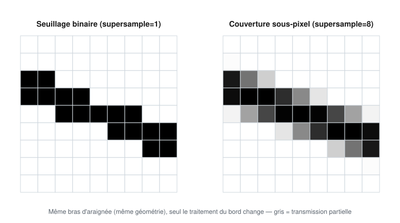

# Pupilles réelles

Les références numérotées [n] renvoient à la [bibliographie](bibliographie.md).

## 10. Pupilles réelles : au-delà du disque plein

La base de Zernike (`eoqual.core.pupil.zernike_basis`, utilisée par
`optics.build_zernike_basis`) n'est **orthogonale que sur une pupille
circulaire pleine, non obstruée**. Toutes nos validations ([§6.4](implementation.md#64-validation), [§8](observation-terre.md#8-cas-dusage--observation-de-la-terre)) ont
utilisé un masque simulé de ce type. Un télescope réel — en particulier en
télédétection ([§8.1](observation-terre.md#81-contexte-spécifique-à-la-télédétection)) — a presque toujours une **obstruction centrale**
et/ou des **bras d'araignée** : sur cette pupille, la base standard n'est
plus orthogonale, les modes se corrèlent, et `condition_number` (déjà
calculé par `zernike_fit.fit_zernike`) s'en dégrade.

Trois solutions existent, par ordre de généralité croissante et
d'interprétabilité physique décroissante :

| Solution | Cas d'usage | Limites |
|---|---|---|
| Polynômes annulaires de Mahajan [18] | Obstruction circulaire centrée, **sans** bras d'araignée | Solution analytique élégante, mais suppose la symétrie azimutale parfaite |
| Gram-Schmidt numérique | Bras d'araignée ou masque de forme quelconque | Seule solution générale ; les modes au-delà des tout premiers ordres ne portent plus le nom usuel (« coma », « trèfle »…) |
| Modes de Karhunen-Loève | Optique adaptative, analyse statistique | Base optimale au sens de la variance, mais perd l'interprétation physique ; nécessite les statistiques d'aberration du système |

Ce projet fournit la solution générale : [`zernike_basis_orthogonal.py`](https://github.com/EOQual/eoqual-phaseretrieval/blob/main/src/eoqual/phaseretrieval/zernike_basis_orthogonal.py)
(`ZernikeGramSchmidt`), qui ré-orthogonalise numériquement la base sur le
masque *réel* fourni (Gram-Schmidt modifié [19, 20], réutilise
`optics.build_zernike_basis` comme point de départ). Vérifié
numériquement : orthogonalité quasi machine-epsilon (`< 1e-14`) aussi bien
sur notre masque plein que sur une pupille annulaire synthétique
(obstruction centrale). C'est un utilitaire **autonome** (`decompose`/
`reconstruct`/`as_basis_array`), et un point d'entrée commun
(`resolve_zernike_basis`) le branche en **option** (`orthogonal_basis:
bool = False`, sur `ZernikeConfig`, `OpticalConfig`, `PhaseDiversityConfig`
et `psf_to_wfe(..., orthogonal_basis=True)` / `--orthogonal_basis` en CLI)
dans les trois méthodes de récupération de phase — désactivée par défaut,
à activer dès qu'un masque non
standard (obstrué, avec araignées) est en jeu. Un garde-fou explicite
(`ValueError`) empêche silencieusement le décalage d'index qui se
produirait si Gram-Schmidt écartait un mode dégénéré (masque trop
obstrué/sous-échantillonné pour `zernike_order`) : voir la docstring de
`resolve_zernike_basis`.

**Mise en garde pour la comparaison à une vérité terrain.** Les
coefficients obtenus avec `orthogonal_basis=True` ne sont *pas*
directement comparables, indice par indice, à des coefficients de
référence exprimés sur la base de Noll standard : même sous-espace de
fonctions, mais une base différente au-delà des tout premiers modes
(§ ci-dessus). Vérifié empiriquement sur une pupille annulaire à 30 %
d'obstruction : la même PSF simulée en base standard, ajustée avec
`orthogonal_basis=True`, donne une corrélation ≈ 0,998 (au lieu de 1,00 en
base standard) avec la vérité *exprimée en base standard* — pas une
régression de la méthode, un effet de changement de base (et de
convergence du solveur, le coût final y étant aussi moins bon).

### 10.1 Simulation cohérente avec `orthogonal_basis`

`eoqual.phaseretrieval.simulation` accepte le même réglage
`orthogonal_basis` (`simulate_psf_from_zernike(..., orthogonal_basis=True)`,
`PhaseDiversitySimulationConfig(orthogonal_basis=True)`) : les
coefficients de vérité terrain sont alors interprétés dans la base
Gram-Schmidt de `mask`, via le même `resolve_zernike_basis` que les
backends, sans décomposition manuelle. Simuler et ajuster avec le même
réglage rétablit une comparaison directe et quasi exacte (corrélation
`> 0,9999`, coût `< 1e-15` sans bruit, `tests/test_simulation_orthogonal.py`)
— y compris pour `"phase_diversity"` : le terme de diversité
(`defocus`) n'est pas affecté par ce réglage, `diversity_phase` n'utilisant
que `basis[3]`, dont la composante piston éventuellement mélangée par
Gram-Schmidt n'a aucun effet sur la PSF (un piston global n'affecte pas
une intensité) — sur un masque centrosymétrique ([§3.7](principes.md#37-lever-lambiguïté-de-signe-par-un-a-priori)). Un masque *non*
centrosymétrique (bras d'araignée asymétriques) pourrait en revanche
laisser fuir un peu de tip-tilt dans ce terme, non pris en compte ici.

### 10.2 Revenir à la base standard pour l'interprétation

`zernike_fit.project_orthogonal_to_standard(coeffs_orthogonal_nm,
orthogonal_basis, mask, wavelength)` reconvertit des coefficients ajustés
en base Gram-Schmidt vers la base de Noll standard (Z4 = défocus,
Z5/Z6 = astigmatisme, …) pour l'interprétation et le reporting — la
conversion inverse de §10.1. Elle reconstruit la phase à partir des
coefficients Gram-Schmidt puis la redécompose sur la base standard via
`fit_zernike`, une opération **linéaire exacte** (aux erreurs de
conditionnement/convergence en amont près) puisque la base Gram-Schmidt
n'est, par construction, qu'une combinaison linéaire des modes standard
jusqu'au même ordre (§10) : la phase qu'elle représente est donc
exactement dans l'espace couvert par la base standard.

Point à connaître avant d'interpréter le résultat : sur un masque obstrué,
un mode Gram-Schmidt d'indice `j` peut mélanger un peu de **piston** (Z1)
au mode standard homonyme (vérifié empiriquement : le mode Gram-Schmidt
« 4 » de l'exemple ci-dessus vaut `-0,170·Z1 + 1,114·Z4`, jamais de
tip-tilt sur un masque centrosymétrique — même argument de symétrie qu'en
[§3.7](principes.md#37-lever-lambiguïté-de-signe-par-un-a-priori)). Cette part de piston est perdue lors de la reprojection (retirée
par `fit_zernike`, comme partout ailleurs dans ce projet — Z1-Z3 non
observables sans référence externe), ce qui explique un léger décalage
d'amplitude entre le coefficient Gram-Schmidt d'origine et son équivalent
standard reprojeté (`+12 %` dans l'exemple ci-dessus, `55 nm` en base
Gram-Schmidt devenant `61,4 nm` de Z4 standard) : rien d'anormal, la
vérité terrain elle-même n'a de sens que dans la base où elle a été
définie. Utiliser plutôt `project_orthogonal_to_standard` pour retrouver
une vérité pensée nativement en base standard (aberration physique connue)
après un ajustement fait en base Gram-Schmidt (`tests/test_simulation_orthogonal.py`,
`test_project_orthogonal_to_standard_recovers_standard_truth_approximately`).

### 10.3 Bord des bras d'araignée : couverture sous-pixel, pas le contour principal

Un masque de pupille discrétisé (`PupilGenerator`) approxime une forme
continue par des pixels entièrement transparents ou opaques. Cette
discrétisation introduit-elle une erreur suffisante pour justifier un
traitement particulier des bords ? Mesuré empiriquement plutôt que
supposé, la réponse dépend **entièrement** de quel bord :

**Contour principal (disque, obstruction centrale) : erreur négligeable
dans le régime normal de ce code, pas de traitement ajouté.**

| `aperture_px` | erreur d'aire du masque binaire | écart de PSF (binaire vs sous-pixel) |
|---|---|---|
| 16 | -2,0 % | 5,0 % |
| 32 | -0,9 % | 2,4 % |
| 64 | -0,25 % | 1,1 % |
| 128 | -0,12 % | 0,56 % |
| 256 | -0,08 % | 0,29 % |

L'erreur décroît en ~1/aperture_px et est déjà sous 0,3 % dès
`aperture_px ≥ 64`, le régime habituel de ce code (voir par exemple le
masque natif rééchantillonné à 98 px sur 128 au [§12](resolutions.md#12-résolutions-multiples--masque-carte-ho-psf-suréchantillonnée) de ce document).
`simple_disk`/`annular` restent donc un seuillage binaire pur — y
ajouter un traitement sous-pixel coûterait un paramètre et une
dépendance supplémentaires pour un gain qui ne devient significatif
qu'à `aperture_px < 32`, un régime déjà dégradé pour d'autres raisons
(sous-échantillonnage de la PSF elle-même).

**Bras d'araignée : artefact numérique mesurable, corrigé par défaut.**

Un bras est fin (largeur de l'ordre du pixel : ex. `width=0.01` sur
`aperture_px=128` → 1,3 px). Un seuillage binaire pur lui donne une
transmission qui dépend de l'alignement sous-pixel de la grille par
rapport au bras — un effet purement numérique, puisque la pupille
physique ne « sait » pas où elle tombe sur la grille :

Mesuré en déplaçant le masque d'une fraction de pixel arbitraire (même
géométrie physique, seul l'alignement change) :

| Décalage sous-pixel | écart de PSF (binaire) | écart de Strehl (binaire) | écart de PSF (sous-pixel, `supersample=8`) |
|---|---|---|---|
| (0,5 ; 0,5) px | 2,0 % | -1,45 % | 0,2 % |
| (0,1 ; 0,4) px | 1,2 % | -0,78 % | 0,13 % |

Augmenter `aperture_px` ne corrige pas cet artefact (le bras reste fin en
valeur absolue, sa largeur étant définie comme une fraction du rayon qui
croît proportionnellement). `PupilGenerator.with_spiders(...,
supersample=8)` (valeur par défaut) calcule donc la bande de chaque bras
sur une grille interne 8× plus fine avant de moyenner
(`eoqual.core.psf.supersampled_coverage`), ce qui
réduit l'artefact d'un facteur ~10 sur le cas ci-dessus. Le contour
principal et l'obstruction centrale, évalués séparément
(`PupilGenerator.annular`), restent inchangés — binaires, comme justifié
ci-dessus. `supersample=1` donne un seuillage binaire pur. Tests :
`tests/test_optics_and_pupil.py`,
`test_pupil_with_spiders_supersampling_stabilises_psf_under_subpixel_shift`
et les deux tests voisins ; eoqual-deconvolution (`psf._supersampled`)
emploie le même utilitaire d'eoqual-core.

**Fenêtres d'apodisation (cosinus, Hann, Tukey, sigmoïde, distance
transform) : hors sujet, volontairement exclues.** Elles répondent à un
objectif différent — modifier *délibérément* la réponse optique (p. ex.
réduire les lobes secondaires d'un instrument apodisé) — et non réduire
une erreur de discrétisation numérique. Les deux objectifs ne doivent pas
être confondus : ce projet ne fournit pas de fenêtre d'apodisation, et la
couverture sous-pixel ci-dessus n'en est pas une (elle ne fait que
représenter plus fidèlement la géométrie *déjà* demandée).
