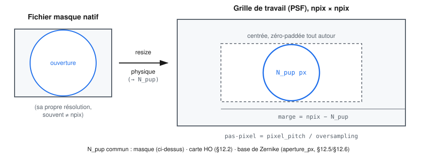
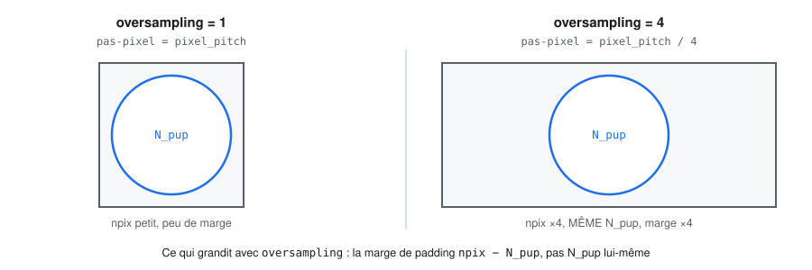
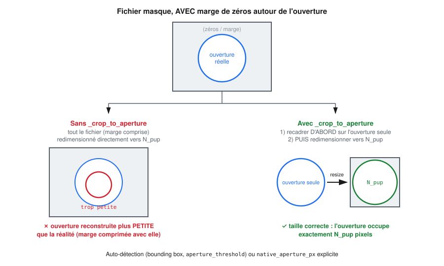
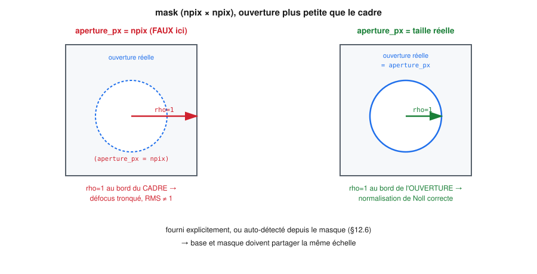

# Résolutions multiples

Les références numérotées [n] renvoient à la [bibliographie](bibliographie.md).

## 12. Résolutions multiples : masque, carte HO, PSF suréchantillonnée

Masque pupillaire, carte de WFE haut ordre (HO, [§11.3](modele-systeme.md#113-statut)) et PSF n'ont pas de
raison de partager la même résolution native : le masque peut venir d'un
outil CAO indépendant, la carte HO d'une mesure de métrologie sur sa
propre grille, et la PSF elle-même peut être **suréchantillonnée**
(reconstruite par super-résolution — Shift-and-Add, ePSF, PSFr, [§5.0](guide.md#50-doù-vient-la-psf-dentrée-) — à
2x, 3x, 4x le pas natif du détecteur). `psf_to_wfe`/`load_and_prepare_mask`/
`load_and_prepare_ho_wfe` prennent ces trois cas en charge.

**Vue d'ensemble** : quelle que soit la résolution native du fichier
masque, tout se ramène in fine à placer une ouverture de `N_pup` pixels,
centrée, dans le cadre `npix x npix` de la PSF — le reste n'est que la
procédure (parfois en deux temps, §12.3) pour obtenir ce `N_pup` sans
perdre ni déformer l'ouverture en chemin :



### 12.1 Le principe : `pixel_pitch` + `oversampling`, pas `detector_size`

Le modèle direct (`phase_from_coefficients`, `psf_from_phase`) n'a qu'une
seule contrainte réelle : masque, base de Zernike/carte HO et PSF vivent
sur la **même grille `npix`** (celle de la PSF), la correspondance
physique passant uniquement par la taille en pixels de l'ouverture sur
cette grille (`N_pup`, `io_utils.compute_pupil_footprint_px`) :

$$
N_{pup}=\frac{\lambda f}{D\,\Delta_{det}}\quad\text{avec}\quad
\Delta_{det}=\frac{\text{pixel\_pitch}}{\text{oversampling}}
$$

où `pixel_pitch` est le pas-pixel **natif** du détecteur (une constante
capteur) et `oversampling` (entier, `1` par défaut) le facteur de
suréchantillonnage de la grille de travail par rapport à cette résolution
native — `4` pour une PSF reconstruite à 4x le pas natif.

**Résultat à connaître, contre-intuitif mais correct** : quand `npix`
grandit proportionnellement à `oversampling` (le cas normal — on lit
simplement `npix` sur le tableau PSF suréchantillonné fourni), `N_pup`
reste **constant**. Le suréchantillonnage revient, dans ce modèle à une
seule FFT, à zero-padder la pupille *autour* de l'ouverture (plus de fond,
même résolution de l'ouverture en pixels), pas à résoudre l'ouverture
elle-même plus finement — exactement la recette standard de zero-padding
en optique de Fourier pour affiner l'échantillonnage en sortie. Ce qui
grandit avec `oversampling`, c'est la marge de padding
`npix - N_pup` (vérifié : `tests/test_multi_resolution.py::test_pupil_footprint_invariant_under_consistent_oversampling`) :



Autrement dit : suréchantillonner la PSF **n'améliore pas** la résolution
angulaire de l'ouverture modélisée (toujours `N_pup` pixels) — ça ne fait
qu'échantillonner plus finement le même plan focal (plus de marge =
support spatial plus grand en sortie de FFT, à résolution pupille
inchangée). C'est volontaire et correct (zero-padding), pas une
limitation à lever.

Avant cette clarification, le paramètre s'appelait `detector_size`
(« taille physique du détecteur » — pas-pixel × nombre de pixels) :
dimensionnellement équivalent (`pixel_pitch = detector_size / N_natif`),
mais son nom suggérait une constante capteur alors qu'il fallait
implicitement le réinterpréter comme « étendue physique couverte par CE
tableau », un contrat non documenté et facile à casser sans s'en
apercevoir. `pixel_pitch` + `oversampling` explicite le rendent
auto-documenté.

### 12.2 Masque et carte HO à leur résolution propre

`load_and_prepare_mask`/`load_and_prepare_ho_wfe` acceptent un fichier à
**n'importe quelle résolution native**, indépendante de `npix` et l'une de
l'autre : chacune redimensionne (via `N_pup` commun, calculé une fois par
`compute_pupil_footprint_px`) puis centre/zero-pad sur la grille de
travail — masque et carte HO finissent donc co-enregistrés même s'ils
viennent d'outils différents (`tests/test_multi_resolution.py`,
`test_load_and_prepare_ho_wfe_rescales_independently_of_mask_resolution`).

Si le fichier a déjà exactement la forme de la PSF, la mise à l'échelle
physique est **ignorée** (`logger.warning`, pas `debug` — pour ne pas
passer inaperçu) : cas normal d'un masque/carte construits directement sur
la grille de travail (simulateur, `PupilGenerator`), mais aussi le piège
signalé en tête de cette section — une coïncidence de forme n'est pas une
preuve d'enregistrement correct si la source est un outil indépendant.

**Perte d'information minimale au rééchantillonnage** :
- Masque (`load_and_prepare_mask`) : interpolation bilinéaire +
  anti-aliasing (au lieu du plus-proche-voisin sans anti-aliasing
  d'avant, qui aliasait les structures fines — bras d'araignée — en
  sous-échantillonnage), puis seuillage binaire par défaut
  (`binarize=True`). `binarize=False` conserve la transmission graduée
  `[0, 1]` au lieu d'un seuil dur — préserve l'information de bord
  sous-pixel ; c'est aussi le bon choix pour une pupille réellement
  apodisée (transmission non uniforme, [§2.2](principes.md#22-modifications-envisageables-pour-les-récupérer)). Aucune méthode de ce projet
  n'exige un masque strictement binaire — `psf_from_phase` accepte déjà
  n'importe quelle amplitude dans `[0, 1]`.
- Carte HO (`load_and_prepare_ho_wfe`) : interpolation **cubique**
  (`order=3`), jamais de seuillage — c'est une grandeur physique continue,
  pas une géométrie binaire ; l'interpolation d'ordre le plus élevé
  disponible est ici la méthode qui perd le moins d'information sur une
  surface lisse.

### 12.3 Ouverture plus petite que le fichier : marge de zéros autour

Cas fréquent en pratique : le fichier masque (ou carte HO) est **plus
grand** que l'ouverture elle-même — exporté sur un cadre de taille fixe,
avec une marge de zéros (ou de valeurs quasi nulles) tout autour, plutôt
que de cadrer exactement sur l'ouverture. `_resample_to_footprint`
suppose au contraire que **tout** le tableau source est l'ouverture, bord
à bord (la convention de `PupilGenerator`) : sans précaution, cette marge
serait comprimée avec l'ouverture dans `N_pup_target` au lieu d'être
ignorée — l'ouverture reconstruite sur la grille de travail ressortirait
alors artificiellement plus petite qu'elle ne l'est réellement.



`load_and_prepare_mask`/`load_and_prepare_ho_wfe` recadrent donc d'abord
sur l'ouverture (`_crop_to_aperture`) avant la mise à l'échelle physique,
sur le chemin de mise à l'échelle physique uniquement (pas quand le
fichier est déjà sur la grille de travail — §12.2, cette marge-là est déjà
la bonne). Deux façons de le piloter :

- **Auto-détection** (par défaut) : la boîte englobante des pixels
  au-dessus de `aperture_threshold` (fraction du maximum du fichier,
  `0.01` par défaut) est recadrée en un carré centré dessus. Sans effet
  quand l'ouverture remplit déjà tout le fichier (recadrage vide). Fiable
  pour un masque net (binaire ou peu bruité) ; à éviter pour une carte HO
  dont certaines zones *à l'intérieur* de l'ouverture peuvent être
  légitimement proches de zéro (rien ne les distingue alors de la marge).
- **`native_aperture_px`** : indique directement le nombre de pixels
  qu'occupe l'ouverture dans le fichier source, quand cette valeur est
  connue (documentée par l'outil qui a produit le fichier) — plus robuste
  que l'auto-détection, en particulier pour une carte HO.

```python
coeffs_nm, phase_fit_nm, diagnostics = psf_to_wfe(
    psf_path, mask_path, wavelength, focal_length, pupil_diameter, pixel_pitch,
    method="optimization",
    mask_native_aperture_px=300,   # ouverture = 300 px dans le fichier masque
    known_ho_wfe_path=ho_wfe_path,
    ho_native_aperture_px=180,     # ouverture = 180 px dans le fichier carte HO (peut différer)
)
```

En CLI : `--mask_native_aperture_px`, `--ho_native_aperture_px`,
`--aperture_threshold`. Testé (`tests/test_multi_resolution.py`,
`test_load_and_prepare_mask_autodetects_padding_margin` et suivants) :
`N_pup_target` reste identique à un fichier sans marge (ne dépend que des
paramètres physiques, jamais de la marge du fichier source), et un cas de
bout en bout avec masque *et* carte HO chacun sur un cadre plus grand que
leur ouverture (tailles de marge différentes entre les deux) recouvre la
vérité de Zernike.

Vérification visuelle (masque natif avec marge, reconstruction correcte
*vs* resize naïf du fichier entier sans recadrage préalable — ouverture
mesurée artificiellement plus petite) : `examples/psf2zernike_demo.ipynb`,
section « Vérification visuelle : le recadrage a bien lieu avant le
changement d'échelle ».

**Ouverture centrée ou non ?** `native_aperture_px` **seul** suppose
l'ouverture **centrée** dans le fichier (même marge des deux côtés, sur
les deux axes) : `r0 = (hauteur_fichier - taille_ouverture) // 2`, et
pareil en colonne. Si ce n'est pas le cas (ouverture décalée dans le
fichier source), deux options :
- Ne **pas** fournir `native_aperture_px` : l'auto-détection localise déjà
  l'ouverture où qu'elle soit dans le fichier, centrée ou non — c'est en
  fait le cas normal pour une ouverture décentrée, aucun paramètre
  supplémentaire n'est nécessaire.
- Fournir en plus `native_aperture_center=(row, col)` (`--mask_native_aperture_center
  ROW COL` / `--ho_native_aperture_center ROW COL` en CLI) : les
  coordonnées pixel du centre réel de l'ouverture dans le fichier —
  utile quand cette position est connue précisément et qu'on préfère
  éviter l'auto-détection (même raison que pour `native_aperture_px` :
  robustesse pour une carte HO, dont l'intérieur peut être proche de zéro
  par endroits). Sans lui, `native_aperture_px` seul sur une ouverture
  réellement décentrée produit un résultat **faux, silencieusement**
  (recadrage au mauvais endroit) — comportement volontairement figé par
  `tests/test_multi_resolution.py::test_native_aperture_px_alone_assumes_centred_and_is_wrong_if_not`,
  pour qu'un changement futur de ce contrat soit visible.

### 12.4 Statut

Implémenté pour les trois méthodes via `psf_to_wfe(..., pixel_pitch=,
oversampling=, mask_binarize=, mask_native_aperture_px=,
ho_native_aperture_px=, mask_native_aperture_center=,
ho_native_aperture_center=, aperture_threshold=)` / `--pixel_pitch`/
`--oversampling`/`--mask_no_binarize`/`--mask_native_aperture_px`/
`--ho_native_aperture_px`/`--mask_native_aperture_center`/
`--ho_native_aperture_center`/`--aperture_threshold` en CLI.
`eoqual.phaseretrieval.simulation` accepte `aperture_px` (§12.5)
pour le suréchantillonnage **en mémoire** — simuler un cas de test avec
masque/PSF à des résolutions **natives** réellement différentes (fichiers
séparés) reste, lui, à construire manuellement (voir
`tests/test_multi_resolution.py` pour le patron).

### 12.5 La base de Zernike doit partager le même `aperture_px` que le masque

**Pourquoi.** `optics.build_zernike_basis`/`zernike_basis_orthogonal.resolve_zernike_basis`
évaluent par défaut chaque mode en supposant que l'ouverture remplit tout
le cadre `npix` (convention par défaut de `eoqual.core.pupil.zernike_basis`,
reprise de `poppy.zernike.zernike_basis`
sans `rho`/`theta` personnalisé). Or le principe même de §12.1
(`oversampling` > 1) est de zero-padder l'ouverture *dans* un cadre plus
grand : elle n'occupe alors que `N_pup_target < npix` pixels. La base doit
être évaluée avec ce même rayon, pas avec `npix`, sous peine d'un
décalage d'échelle entre masque et base.

**Ce qui ne va pas sans ça.** À l'intérieur de la *vraie* ouverture, un
mode comme $Z_4$ (défocus) ne parcourt plus qu'une fraction tronquée de
sa dynamique propre (p. ex. $-1,73$ à $-0,84$ au lieu de $-1,73$ à
$+1,73$), et sa RMS sur l'ouverture n'est plus $1$ comme l'exige la
normalisation de Noll (p. ex. $1,32$) : un défocus simulé n'a plus la
forme physique d'un vrai défocus, et un coefficient récupéré n'a pas
l'échelle qu'il prétend avoir.



**Le mécanisme.** Un paramètre `aperture_px` (diamètre \[px\] de
l'ouverture dans le cadre `npix x npix`), partagé de bout en bout via
`pupil.polar_grid(npix, aperture_px)` — la même grille `(rho, theta)`
(`rho == 1` au bord de l'**ouverture**, pas du cadre) utilisée à la fois
par `PupilGenerator(npix, aperture_px=...)` (délimiter le masque) et par
`optics.build_zernike_basis(npix, nterms, aperture_px=...)` (évaluer la
base à la même échelle, via le `rho`/`theta` personnalisé que
`eoqual.core.pupil.zernike_basis` accepte nativement). Propagé à travers
`zernike_basis_orthogonal.ZernikeGramSchmidt`/`resolve_zernike_basis`,
`zernike_fit.ZernikeConfig`/`fit_zernike`/`project_orthogonal_to_standard`,
`backends.optimization.OpticalConfig`,
`backends.phase_diversity.PhaseDiversityConfig`, et `pipeline.psf_to_wfe`
(qui transmet le `N_pup_target` qu'il calcule déjà — `None` si le masque
est déjà sur la grille de la PSF, le cas le plus courant ; aucun
changement d'API publique). `PupilGenerator`/`simulate_psf_from_zernike`/
`PhaseDiversitySimulationConfig` acceptent aussi `aperture_px` directement,
pour suréchantillonner **en mémoire** (sans fichier) de façon cohérente
masque+base — voir [§6.7](implementation.md#67-module-de-simulation-données-à-vérité-connue) et `examples/psf2zernike_demo.ipynb`.
`aperture_px=None` (par défaut partout) reproduit le comportement sans
marge (ouverture remplissant le cadre) ; vérifié par
`tests/test_optics_and_pupil.py::test_build_zernike_basis_aperture_px_none_matches_historical_default`.

### 12.6 `aperture_px` auto-détecté depuis un masque personnalisé

**Pourquoi.** §12.5 suppose que l'appelant pense à fournir le bon
`aperture_px` chaque fois qu'il passe un `mask` dont l'ouverture ne
remplit pas tout le cadre — vrai pour les masques générés en interne par
`pupil.PupilGenerator(npix, aperture_px=...)`, mais pas pour un masque
"calculé par ailleurs" (une autre fonction de l'appelant, un masque
chargé puis manipulé hors de `io_utils.load_and_prepare_mask`...). Sans
le bon `aperture_px`, le décalage d'échelle de §12.5 revient par un
chemin différent : un masque personnalisé passé à
`simulate_psf_from_zernike`/`fit_zernike_from_psf` sans `aperture_px`
explicite serait silencieusement traité comme si son ouverture remplissait
`npix` entier — avec un biais sur les coefficients de Zernike estimés qui
**dépend de `npix`** (plus l'ouverture réelle est petite devant `npix`,
plus le décalage est sévère).

**Le mécanisme.** `zernike_basis_orthogonal.resolve_zernike_basis` — le
point d'entrée commun aux trois méthodes et à `simulate_psf_from_zernike`
— auto-détecte `aperture_px` depuis le `mask` fourni quand il
n'est pas donné explicitement, via `pupil.detect_aperture_px` (bounding
box des pixels non nuls du masque, ouverture supposée centrée comme
`polar_grid`). `aperture_px=None` signifie donc "détecter l'ouverture réelle depuis le
masque", et non "l'ouverture remplit le cadre" — ce qui revient au même
dès que le masque remplit effectivement le cadre (disque plein par défaut de
`PupilGenerator`), car sa bounding box vaut alors `npix` exactement
(vérifié par régression). Donner `aperture_px` explicitement reste
possible pour court-circuiter la détection (masque dégradé/apodisé dont
la bounding box ne reflète pas bien l'ouverture physique, ou convention
différente comme `N_pup_target`).

Un léger artefact de discrétisation (±1 px) existe entre le diamètre
passé à `PupilGenerator(aperture_px=...)` et la bounding box mesurée en
retour sur le masque généré (fenêtre de pixels inclusive aux deux bords),
sans consequence pratique : simulation et ajustement redétectent
indépendamment le même `aperture_px` depuis le *même* masque, donc la
même légère valeur décalée des deux côtés — un round-trip simulate+fit
reste exact (vérifié par régression,
`tests/test_aperture_px_autodetect.py`).

### 12.7 Piège distinct : reconstruire soi-même la « vérité » avec `build_zernike_basis`, en oubliant `N_pup_target`

**Pourquoi.** §12.5/§12.6 couvrent les chemins qui passent par
`resolve_zernike_basis` — c'est-à-dire les trois méthodes de
`psf_to_wfe` et `simulate_psf_from_zernike` : celui-ci reçoit déjà
`aperture_px`, ou l'auto-détecte depuis un `mask`. Un script qui
construit sa propre PSF de « vérité » en appelant
`optics.build_zernike_basis` **directement** — par exemple pour
injecter des coefficients de Zernike connus et vérifier qu'ils sont
bien récupérés ensuite par `psf_to_wfe` — contourne ce point d'entrée
commun. `build_zernike_basis` ne prend pas de `mask` en argument : rien
depuis quoi auto-détecter (§12.6 ne s'applique pas ici). Il reste
entièrement à la charge de l'appelant de lui passer le bon
`aperture_px`.

**Le piège.** `load_and_prepare_mask(psf_shape, mask_path, ...)` renvoie
`(mask, N_pup_target)`. Si ce second élément est jeté
(`mask_ref, _ = load_and_prepare_mask(...)`) puis que la vérité est
construite avec `build_zernike_basis(npix=mask_ref.shape[0],
nterms=order)` (sans `aperture_px`), la base de « vérité » suppose à
tort que l'ouverture remplit tout le cadre `npix` — exactement le
décalage d'échelle de §12.5, mais appliqué cette fois à la génération de
la vérité plutôt qu'à l'ajustement. Le symptôme est trompeur :
`psf_to_wfe`/`fit_zernike_from_psf`, eux, passent par
`resolve_zernike_basis` et détectent correctement l'ouverture réelle
(`N_pup_target`) depuis ce même masque — l'ajustement converge donc très
bien (coût d'optimisation très faible, l'ajustement reproduit fidèlement
*son propre* modèle), mais sur une échelle différente de celle de la
« vérité » mal construite. Les coefficients de Zernike récupérés — et la
RMSE de WFE comparée à cette vérité — n'ont alors rien à voir avec les
coefficients injectés, malgré un ajustement en apparence réussi.

**La correction** : conserver `N_pup_target` et le passer explicitement :

```python
mask_ref, n_pup_target = load_and_prepare_mask(
    psf_shape=(128, 128), mask_path=mask_path,
    wavelength=..., focal_length=..., pupil_diameter=..., pixel_pitch=...,
)
basis = build_zernike_basis(npix=mask_ref.shape[0], nterms=order, aperture_px=n_pup_target)
```

Illustré pas à pas, avec un masque natif à résolution différente de
celle de la PSF (comme un fichier `mask.tif` réel), dans
`examples/psf2zernike_demo.ipynb`, section « Masque à résolution native
différente de la PSF » — tableau vérité/sans `aperture_px`/avec
`aperture_px`, et coûts d'optimisation comparés.
